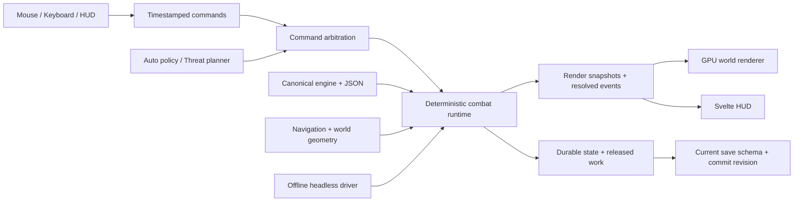

# Combat revamp — งานที่เหลือ

รอบ audit 28 ตุลาคม 2026 (ROX เป็น reference ด้าน combat feel เท่านั้น) งานที่ปิดแล้วถูกตัดออกจากเอกสารนี้ทั้งหมด เหลือเฉพาะงานที่ยังไม่ทำ + เงื่อนไขผ่าน + คำถามที่ต้องตัดสิน

## ทิศทาง (คงเดิม)

- Combat ตอบสนองทันที เดินหาเส้นทางจริง จังหวะอ่านได้; **auto combat เป็นแกน ผู้เล่นมอง + จัดของ + ตั้งค่าสกิล**
- Stylized 3D กล้องมุมเฉียง (2.5D) + Svelte HUD; ผลิตภาพ/asset หลัง vertical slice + benchmark เท่านั้น กราฟิกพักจนกว่า gameplay จะนิ่ง
- ไม่ใช้ Melvor หรือ idle-game ใดเป็น reference ของ engine/idle architecture; gameplay numbers อยู่ใน data JSON เจ้าของเดียว (AGENTS.md)

## ข้อห้าม / สิ่งที่ต้องรักษา (ของงานที่เหลือ)

1. Canonical JSON และ shared engine formulas เจ้าของเดียว
2. Microsecond event ordering, death halt, windup/release/impact/recovery และ resource/cooldown commitment
3. Released work identity — เปลี่ยนภาพห้ามดาเมจซ้ำหรือคืน resource ที่จ่ายแล้ว
4. Swept collision, body radius, contact claims, sticky target/focus
5. Deterministic replay — comparator ต้อง total order (`roster-order.ts`)
6. Account Web Lock, serialized save session, storage failure handling
7. "nearby" มี spatial owner เดียว — ห้ามวน `group` ตามลำดับ array

## สถาปัตยกรรมเป้าหมาย (คงเดิม)

- **Combat driver:** simulation ครั้งละ 50 ms ต่อเนื่อง ใช้ integer combat clock ไม่ผูก rendered frames; batch sizes ต่างกันต้องให้ event order/cost/damage/reward เดิม
- **World/economy driver:** งานรายวินาทีสะสมเวลาจาก combat runtime ห้าม double advance (regen, cooldown, DoT, food, contracts, clockSec)
- **Command owner:** sequence/time/type จุดเดียวตัดสิน acceptance, supersession, buffer, cancel; รายงาน accepted/queued/rejected พร้อม reason
- **Live rendering:** interpolation ไม่เกินหนึ่ง combat step; HP/resource/damage รอ authority ห้าม renderer สุ่มผล; replay ใช้ driver แยก
- **Renderer:** Three.js WebGL2 เป็น candidate หลัก; Svelte ดูแล HUD ไม่ย้ายสูตรเข้า renderer
- **Worker:** แยกได้หาก profile ระบุ main-thread contention ไม่ใช่คำตอบแทนการวัด

ลำดับส่งงาน: `P1 → P2 → P3 → renderer decision → P4/P5/P6 → P7 cutover → P8` P4/P5/P6 ขนานได้หลัง interface เสถียร ห้ามผลิตสกิล/animation ทั้งเกมก่อน slice ตอบสนองและ timing ผ่าน

## P1 — Combat runtime (เหลือ driver)

- Continuous 50 ms combat driver: แยก time base เป็น `clockSec + subSecUs` แยก world stages ออกจาก combat window รักษา determinism — refactor หลายรอบ ไม่ใช่ patch เดียว (F01 ยังแดง +750 ms)
- Queue ข้าม tick: latest command supersession + one active action + bounded pending request
- Hold-the-line gate ต้องคุม per-sample ensureIntent ด้วย (ปัจจุบัน gate อยู่แค่ tick-start กดครั้งเดียว; per-sample สั่ง rotation ใหม่ได้โดยไม่เช็ค hold) — เงื่อนไขก่อน filler แบบ cd 0 (ลองแล้วต้องถอย: double_strike/sidestep/pierce_the_veil กลับไป cd เดิมเพราะยิงทะลุ hold ทุก sample)
- ตั้ง numeric acceptance gate หลัง driver เดิน (เลื่อนมาจาก P0 เพราะ cadence จะเปลี่ยน)

ผ่านเมื่อ: trace ยืนยันคำสั่งถูกกินใน combat step ถัดไป ไม่มี world tick ซ้ำ RNG/event ordering ทำซ้ำได้ lifecycle cancel/release/death/recovery ผ่าน regression

## P2 — Navigation (เหลือ 2 ชิ้น)

- Waypoint smoothing
- Replan ตามเวลาเมื่อเป้าเคลื่อนที่

ผ่านเมื่อ: เดินอ้อม wall/corner/narrow passage ได้ตาม body radius, moving target ไม่ทำให้วน/สั่น, unreachable goal จบพร้อม reason, auto/manual ไม่แย่งกัน และไม่มีการเดินหนีเข้ากำแพงหรือ hazard อีกวง

## P3 — ยังไม่เริ่มทั้งเฟส

- ฉากเดียวมี terrain/obstacle จริง + prop + camera framing; melee fighter, ranged enemy, heavy ground threat เป็น acceptance scenarios
- GPU scene candidate พร้อม rig, equipment attachment, shadows, depth/occlusion, click picking ตรง collider
- Camera dead zone, bounded damping/look-ahead, zoom range, fade สิ่งบังตัวละคร — easing ห้ามเปลี่ยน range/hit-test
- เทียบ fixture เดียวกับ baseline ทั้ง visual timing และ performance ก่อนเลือก library/version
- Loading/prewarm/error fallback, disposal, พฤติกรรมเมื่อ WebGL context หาย — ระหว่าง presentation ใช้ไม่ได้ต้อง pause sim และให้เล่นผ่าน HUD ได้

ผ่านเมื่อ: เดิน/ตี/สกิล/target/HP ตรงกันครบวงจรในฉากใหม่, player/threat ไม่ถูก HUD บังใน safe area, command feedback ผ่าน target และเลือก renderer จากหลักฐานได้

คำถามที่ต้องตัดสินก่อน P3: ผู้เล่นตัดสินใจอะไรในแต่ละโหมด (farming/elite/boss) และ Manual/Assist/Auto สัญญาอะไร; คุณสมบัติใดของ ROX ที่รับมา; input/targeting grammar เต็ม; camera priority ระหว่าง player/committed target/ground danger; animation กับ commitment ที่ ASPD สูง; workload/degradation ตัดอะไรก่อน; lifecycle เมื่อ presentation ใช้ไม่ได้; accessibility contract; active play ได้เปรียบ unattended แค่ไหน

## P4 — ยังไม่เริ่มทั้งเฟส

- กำหนด units, scale, feet/root pivot, skeleton, sockets, clip/event schema + validator (ต้องแก้ ownership doc ให้รองรับ model/rig/clip ก่อนนำเข้า)
- Locomotion blend + turn/start/stop, weapon families, windup/release/recovery, channel, hit reaction, death/despawn — ใช้ action timing จาก sim
- Contact pose/socket สัมพันธ์กับเป้าหมาย; damage ไม่ขึ้นกับ clip จบหรือ frame rate
- Phase floor: windup/recovery มีความยาวขั้นต่ำที่ animation เล่นได้ (F44)
- ครอบคลุม active roster + equipment; fallback ที่เปิดใช้จริงต้องรายงานชื่อ

ผ่านเมื่อ: ทิศ/feet/อาวุธไม่ลอย ความเร็วเดินสัมพันธ์ระยะ release/impact เข้า beat transition ไม่มี snap และทุก runtime identity resolve ได้ตาม manifest

## P5 — เหลือ 5 ชิ้น

- F22 นโยบาย in-combat equip
- F23 identity ของ single-target / pack-clear / sustain + เพดานการลาก
- Behavior roles + counterplay เต็มรูป (contact melee, skirmisher, ranged spacing, committed charge, artillery, support, boss phase)
- F25 ที่เหลือ: adds, shield break, retreat, reward settlement
- Balance baseline ใหม่หลังพฤติกรรมเปลี่ยน (damage taken, kill throughput, mana pressure, uptime, push frequency เทียบ fixture เดิม)

ผ่านเมื่อ: ผู้เล่นอธิบายได้ว่าถูกโจมตีอะไร/หลบหรือ interrupt อย่างไร auto ทำซ้ำได้ แต่ละ role ตัดสินใจต่างจริง และไม่มี reward/resource regression

## P6 — เหลือ 4 ชิ้น

- F35 picking priority: HUD → armed skill → target/focus → inspect → ground
- F43 safe-area จาก HUD จริง + clamped labels + keyboard aim path
- F14 quality contract: Full/Reduced/Minimal มีผลทุก presentation path คง threat readability
- Viewport culling + list virtualization (วัดก่อน; ไม่ virtualize 16 skill slots โดยไม่มีเหตุผล)

ผ่านเมื่อ: combat อ่านได้โดยไม่เปิด log UI ไม่กิน ground clicks layout editor ใช้ได้หลังย้าย region

## P7 — เหลือนโยบาย

- Mirror/DB conflict, future-schema guard, partial-backend failure (schema 26 คงเดิม)
- Settle cap ผูกกับ ruleset ไม่ใช้ค่าคงที่

ผ่านเมื่อ: latest schema replacement สำเร็จ stale async เขียนทับใหม่ไม่ได้ conflict ตัดสินได้ future schema ไม่ถูกลด partial failure ไม่เสียสำเนาเดียว reload ระหว่าง release/impact ไม่จ่ายซ้ำ offline ไม่เพิ่ม reward จากการสลับโหมด

## P8 — ยังไม่เริ่มทั้งเฟส

- VFX สุดท้ายบอก range/direction/release/impact ตรงกติกา; sound cues + voice limit/mute/preload; hit stop/shake เป็น presentation ล้วน
- Effect budgets/tiers คงข้อมูลภัย; ตรวจ high-speed playback, crowded encounter, reduced motion
- ลด debug-only controls ออกจาก production; retire presentation paths เก่าหลัง cutover

ผ่านเมื่อ: ปิด effects ลงแล้วยังเล่น/หลบได้ ภาพ/เสียงไม่หลอก hit timing ไม่มี hidden legacy path ใช้ setting/clock คนละชุด

## Performance targets — ยังไม่วัด

| ตัวชี้วัด | เป้าหมายเสนอ | เงื่อนไขการตัดสิน |
|---|---|---|
| Visual cadence | 60 FPS ที่ 1920×1080; p95 frame time ≤16.7 ms | ระบุเครื่อง/browser/power mode + workload ก่อน |
| Command acknowledgement | p95 ≤100 ms | วัด input received → first visible feedback |
| Command → authoritative motion | p95 ≤100 ms นอก action lock | รายงาน lock/refusal แยก ห้ามตัดตัวอย่างช้าออก |
| Damage/HP timing | เปลี่ยนตาม resolved impact event | ตรวจหลาย refresh rates ไม่ผูก damage กับ animation callback |
| Load/stress | 48 actors baseline; 96/200 เป็น diagnostic | ไม่ใช่ gameplay population requirement |
| Resource lifetime | กลับสู่ระดับคงที่หลัง warm-up | กำหนด numeric budget หลัง baseline |
| Offline catch-up | กำหนดเวลารับได้จาก baseline | correctness + no duplicate rewards ต้องผ่านก่อน |

## Reference ภายนอก

- Three.js: [WebGLRenderer](https://threejs.org/docs/pages/WebGLRenderer.html), [GLTFLoader](https://threejs.org/docs/pages/GLTFLoader), [animation system](https://threejs.org/manual/pages/animation-system.html) — ความเป็นไปได้ ไม่ใช่หลักฐานความเร็ว
- Sprite สำรอง: [PixiJS performance guidance](https://pixijs.com/8.x/guides/concepts/performance-tips) — ต้องวัดกับ scene จริง
