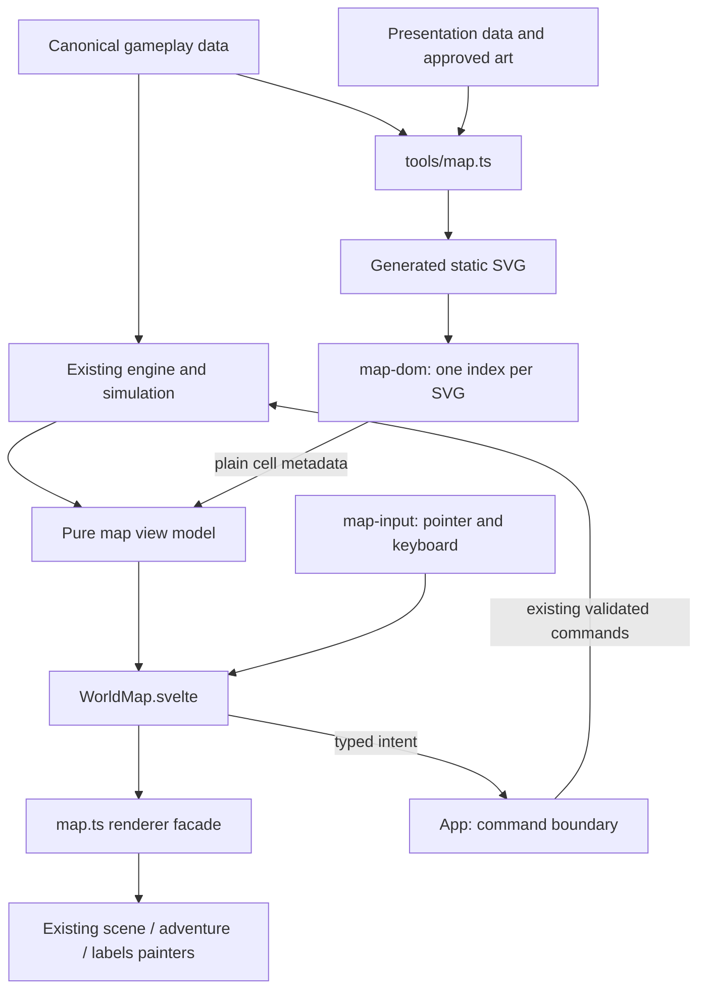

# Modular Hex Map Coding Architecture

Status: hand-off plan for implementation only; runtime code has not been changed.

The goal is to separate the map out of `App.svelte` so that terrain, landmarks, markers and activities can be added at their owner, while continuing to use the existing SVG generator, engine and renderer. This work comes before adding beauty as described in the [layout plan](modular-hex-map-layout.md) to separate code-move bugs from visual changes.

## 1 Architecture chosen



Four boundaries to preserve:

1. **World rules:** engine/sim owns coordinates, walking, monster spawning, resources and activity permission.
2. **View model:** reads state and returns display data as a pure function, testable without a browser.
3. **Rendering:** receives decided data, places images and changes the DOM according to the camera.
4. **Input:** translates gestures/keys into selection, camera changes or intents sent back to App.

No ECS, plugin framework, event bus, renderer registry or one-class-per-hex is added.

## 2 Target file structure

Add four production files and use existing modules as the main body:

```text
game/src/ui/map/
  WorldMap.svelte          NEW: lifecycle, reactive wiring, map surface
  map-view-model.ts       NEW: plain types and pure state-to-view conversion
  map-dom.ts              NEW: SVG validation and one shared DOM index
  map-input.ts            NEW: delegated pointer/keyboard lifecycle
  map.ts                  EXISTING: renderer facade and surface/name/hover painting
  map-scene.ts            EXISTING: projection, upright transforms, depth and culling
  map-adventure.ts        EXISTING: adventure model and its feature painter
  map-camera.ts           EXISTING: camera math and camera state type/defaults
  map-projection.ts       EXISTING: the single projection geometry
  map-markers.ts          EXISTING: typed PNG glyph and medallion markup
  map-labels.ts           EXISTING: label text/layout rules
  map-terrain.ts          EXISTING: terrain asset selection
  map-sprites.ts          EXISTING: measured sprite bounds and placement
  map-intel.ts            EXISTING: readable destination information
  destination.ts          EXISTING: primary action and refusal explanation
```

`tools/map.ts` remains the generator/CLI, `tools/data/map.json` is the presentation data, and `engine.json → road` owns the world topology. Do not add another JSON set that duplicates coordinates or placement.

## 3 Boundaries and API

### 3.1 WorldMap component

Required props:

| Prop | Meaning |
|---|---|
| `markup: string` | SVG from the existing loader/import; this component does not create a duplicate loading service |
| `state: GameState` | read only to build the view model |
| `selected: Picked \| null` | selection shared by App with Journey/TravelCard |
| `camera: MapCameraState` | bindable view state; App owns the lifetime so it does not reset when switching panels |
| `options: MapViewOptions` | mode, guide level and flags the map actually uses |
| `interactive: boolean` | accepts input when the map is in focus; not gameplay write permission |
| `onintent(intent)` | reports selection/clear/activation back to App |
| `announcement: string` | aria-live text from the existing destination/selection owner |

Use `MapCameraState = { panX: number; panY: number; zoom: number; bearing: number }` in `map-camera.ts`. Move defaults/limits from App while keeping the same values. Every toolbar uses the public view methods `zoomBy(factor)`, `setBearing(degrees)`, `resetCamera()`, `centerAt(hex)` so that clamping/anchoring has a single owner.

The only intents are:

```ts
type MapIntent =
  | { type: 'select'; cell: Picked }
  | { type: 'clear-selection' }
  | { type: 'activate'; cell: Picked };
```

App receives `select` and updates the selection/opens Journey with the existing behavior. It receives `activate` and calls the existing primary-action handler, which checks `destinationPrimary()` and permissions before commanding a walk, hunt, gather or city entry. Enter and the button on the destination card use this handler together. Warp remains an explicit action in the existing system.

WorldMap does not call `startWalk`, `warpTo`, `startFieldAction`, `huntHere` or change GameState itself.

### 3.2 Pure view model

Move `Picked` and `MapViewOptions` to `map-view-model.ts`; change `PaintOpts.gameState: any` to a typed input during the migration, then remove GameState from painter signatures in the final step.

```ts
interface MapPaintInput {
  state: GameState,
  cells: readonly MapStaticCell[],
  selected: Picked | null,
  options: MapViewOptions,
}

type MapPaintModel = ReturnType<typeof buildMapPaintModel>;
```

Let `buildMapPaintModel(input: MapPaintInput)` infer the return type from the implementation and use the alias above as the single owner of the shape.

Values required in the snapshot: options, axial keys of the player/selection/camp, selected town, here/target town, walking flag, route/walked keys, adventure marks/placements and the text/visibility the label layer needs. Compute via the existing `currentCell`, road helpers, `adventureView`, discovery/intel and label helpers.

`MapStaticCell` uses the metadata the generator puts in the SVG: axial key, display key, town/zone/sub/site, terrain, original title and polygon geometry, based on the existing `AdventureCell`. Do not create a new world table.

Key Svelte requirement: call the builder in `$derived` or `$effect` synchronously before sending the result to the renderer, so reads of deep `$state` are tracked. Sending only the root GameState to read inside rAF later may lose dependency tracking.

The snapshot holds no GameState pointer, DOM node or gameplay-command function. Painters do not re-read state in a frame and do not serialize/clone GameState to find a dirty key.

Keep the semantic source of markers, such as mob, camp encounter, camp, trail site and resource, as a typed discriminant in AdventurePlacement so the painter can choose CSS classes/markup from that data. Move logic that reads `cls.startsWith(...)` or parses words out of labels to receive an explicit field when moving that painter; do not add another separate registry layer.

### 3.3 Shared DOM index

`createMapDomIndex(svg)` in `map-dom.ts` is created once per SVG instance, combining data from the existing SheetIndex, SceneIndex and AdventureIndex:

- SVG/group/paper/layer refs the renderer needs
- polygons, actors and figures for each axial key
- lookups by axial key, display key and town ID
- immutable cell metadata, original titles and cached polygon centers/radii

App does not hold per-hex Element refs and does not query the SVG to find destinations. Keep the axial key from `hexKey()` as identity; display keys such as A1 and place names are display data.

Validate required root/groups, duplicate keys, non-integer/non-finite coordinates and malformed geometry before accepting the index. If wrong, report a map-local error; do not silently convert a malformed cell to `0,0`. Missing images use the existing fallback and are not topology errors.

When the SVG is replaced because of retry/HMR, dispose the old instance and create a new index. Always scope selectors under its own root; do not use document-wide lookups per cell.

### 3.4 Renderer facade

Add a lifecycle facade in `map.ts` while letting the existing feature painters keep working:

```ts
createMapRenderer(root): {
  readonly cells: readonly MapStaticCell[];
  updateModel(model: MapPaintModel): void;
  updateCamera(camera: MapCameraState): void;
  setHover(axialKey: string | null): void;
  pick(target: EventTarget | null): Picked | null;
  resize(): void;
  destroy(): void;
};
```

The facade owns only the index, pending frame, latest snapshot and dirty flags; it does not create a new scene graph. Move overlapping painter calls out: currently `paintSheet()` calls `paintMapScene()` and App also calls the scene another way. In the final step the facade is the single point that determines the call order.

| DOM writer | What it owns |
|---|---|
| WorldMap/Svelte | wrapper, region classes, outer pan/zoom style, focus and aria-live |
| Surface painter in map.ts | terrain presentation, route/walked/selected/standing classes and player presentation |
| Adventure painter | discovery/threat/activity/camp/trail attributes and marker content |
| map-scene.ts | board projection, upright transforms, depth ordering and culling |
| Name/hover painters in map.ts | nameplate content/layout and hover decoration |

Pass selected/camp/discovery from the snapshot to each painter; do not read CSS class results that another painter just wrote to decide new logic. Keep existing attribute/markup diffing to avoid writing duplicate values.

### 3.5 Input controller

Move `mapField()` and map-only pointer/key helpers out of App into `map-input.ts`. Attach listeners at the root in one set and return `destroy()` to detach everything.

- Click selects a cell; a gesture that ends as drag/orbit does not become a click.
- Wheel zooms around the pointer; drag pans; Ctrl-drag orbits; use the camera helpers and current values.
- Arrows select one of the six neighbors according to screen direction; use cached projected centers instead of reading six bounding rects on every keypress.
- Enter sends activate once per press; Escape clears; keyboard-shortcut contention keeps existing behavior.
- pointercancel, lost capture, blur and unmount clear gesture state.
- The controller does not know loot prices, level gates or gameplay permissions.

Separate the neighbor-selection function from listener attachment so it can be tested with numeric points without a DOM package.

## 4 Invalidation and lifecycle

One WorldMap has its own renderer/input/ResizeObserver and pending rAF. Multiple updates before the next frame use the latest snapshot and at most one queued rAF. When there is no dirty work, stop scheduling.

| What changed | Work required |
|---|---|
| SVG instance | rebuild index/geometry and paint every layer |
| Map-relevant gameplay state | rebuild the pure snapshot and patch related surface/adventure/names |
| Selection | patch selection/marker state and label priority |
| Hover | patch old/new hover and label priority |
| Pan/zoom | viewport transform, culling and label positions; do not re-sort depth |
| Bearing | projection, depth order, upright transforms, culling and labels |
| Resize/font metrics | re-read the viewport and re-measure needed labels |

When the player moves hexes, adjust player depth from the cached cell order. Adding a marker in an actor slot is not a reason to build new geometry.

Batch layout reads before writes where possible. For new/changed label text, batch text writes and measure in one pass, then position. Cache dimensions by text/font signature; camera-only updates do not call `getBBox()` again for every label.

Separate `interactive` from visibility. A map outside the focus may still be background; do not treat it as requiring unmount every time the field opens. If the whole region is truly hidden, stop drawing work and flush the latest snapshot when it returns, while simulation keeps running through the existing owner.

When markup changes, wait for the DOM commit before creating a new renderer and cancel stale completions that arrive late. `destroy()` must be safely idempotent: detach listeners/observer, cancel rAF and do not patch a detached SVG again.

## 5 How to extend after the architecture is in place

| What is added | Main edit point | What should not need editing |
|---|---|---|
| New terrain image | asset catalogue + actually measured metadata + generator checks | input, travel commands, camera math |
| New landmark at an authored location | location/presentation owner + art catalogue | main game loop and pointer handlers |
| Marker for existing data | typed glyph/style + adventure view producer + tests | DOM traversal of the whole map |
| New gameplay activity | engine/sim owner first, then add primary action and marker view | renderer scheduler |
| New Zone/Subzone | canonical data, road/spawn validation and generator | hand-authored SVG or roster count in the client |
| Camera change | camera/projection helpers and tests | fieldwork/drop formulas |

Visual data in `map.json` does not grant activity permission. Drawing a pond does not enable Fishing and having a mine mouth does not create Mining without real source data. Use [section P4a](mob-variant-level-placement.md) as the resource-integration requirement.

## 6 Implementation order

| Step | Work | Check at end of step |
|---|---|---|
| ARC-0 | Read callers, capture behavior of pan/orbit/zoom/select/Enter and related DOM snapshots | There is a baseline of current behavior; do not open art or change visuals with the refactor |
| ARC-1 | Create map-view-model and move pure read logic/typed data | Before/after results are equal and the model does not mutate state |
| ARC-2 | Merge the DOM index and let painters receive index/snapshot | One owner per SVG index; SVG replacement does not use old refs |
| ARC-3 | Add renderer lifecycle and dirty scheduling | No duplicate scene paint; hover/camera do not rebuild the world |
| ARC-4 | Move surface/input/camera wiring into WorldMap and connect intents back to the existing handlers in App | Keyboard, route, resource and shared destination actions keep working |
| ARC-5 | Remove helpers/imports/compatibility wrappers with no callers left, and check integration | App has no map DOM traversal or map-specific event listener lifecycle |

Move one boundary at a time and run focused tests after each step. Do not move while opening the diorama, changing the placement schema, changing travel rules or creating new assets. Temporary forwarding exports may be used during the migration and must be removed when there are no callers.

## 7 Tests and acceptance criteria

Use the existing suites: `map-camera`, `map-projection`, `map-adventure`, `map-markers`, `map-labels`, `map-scene`, `map-terrain`, `map-exploration`, `map-encounters` and `destination` tests.

Add only `game/tests/ui/map-view-model.test.ts` and `game/tests/ui/map-input.test.ts` for the new pure parts. Check DOM/lifecycle with the browser harness/tools the project uses; do not add a DOM emulator or browser framework just for this refactor.

| ID | Pass criterion |
|---|---|
| ARC-01 | World and gameplay-command data still have their existing owners; no duplicated formulas/coordinate tables |
| ARC-02 | The pure builder can be imported/run in Node, does not read window/document and does not change GameState |
| ARC-03 | Changing only map-related values changes the snapshot accordingly; HP unrelated to the map does not force a geometry rebuild |
| ARC-04 | Reads deep reactive state before queueing rAF; no stale markers from reading state outside dependency tracking |
| ARC-05 | One SVG creates the index once; hover/pan/zoom do not rebuild the index and pan-only does not sort depth |
| ARC-06 | Multiple updates before a single frame use the latest data and cause at most one DOM flush |
| ARC-07 | Arrow selection is correct when the camera is rotated, including map edges and cases with no neighbor in that direction |
| ARC-08 | Enter/primary button gives the same action/refusal, and readonly is not skipped through a callback |
| ARC-09 | Drag does not become a click; pointercancel/teardown does not leave listeners or gestures behind |
| ARC-10 | SVG retry/replacement and repeated mount/destroy do not patch old nodes or accumulate extra rAFs |
| ARC-11 | Discovery, marker stacking, blue medallion/leader, terrain and label behavior are unchanged |
| ARC-12 | Real check at 1920 × 1080: select, pan, zoom, orbit, arrows, Enter and resource destinations pass with no unexpected console errors |

Test data must include mine/grove/fishing, town, Subzone, unexplored cell, live combat, camp encounter, trail site and long labels. Use the existing fixture/data owners; do not create another numeric world just to make tests pass.

```text
npm --prefix game run test -- tests/ui/map-view-model.test.ts tests/ui/map-input.test.ts
npm --prefix game run test -- tests/ui/map-camera.test.ts tests/ui/map-projection.test.ts tests/ui/map-adventure.test.ts tests/ui/map-markers.test.ts tests/ui/map-labels.test.ts tests/ui/map-scene.test.ts tests/ui/map-terrain.test.ts tests/ui/map-exploration.test.ts tests/ui/map-encounters.test.ts tests/ui/destination.test.ts
npm run map:check
npm --prefix game run check
npm run build
```

If you change the generator, regenerate with the existing command before map checks and check the diff to confirm no coordinates/gameplay data changed. When a shared contract affects other parts, run related/full tests per [AGENTS.md](../../AGENTS.md) and report unrelated baseline failures separately.

Measure performance as before/after on the same workload: SVG load time, number of index builds, depth sorts, DOM flushes and frame intervals. Time numbers are watches; do not claim the refactor is faster without measured results, and do not use file counts or line counts as proof that the code is clean.

When ARC-01–ARC-12 pass, visual changes per the layout plan may begin. This document does not instruct implementation to start until the owner orders it, and delete the plan when done per the [docs/plan rules](README.md).
