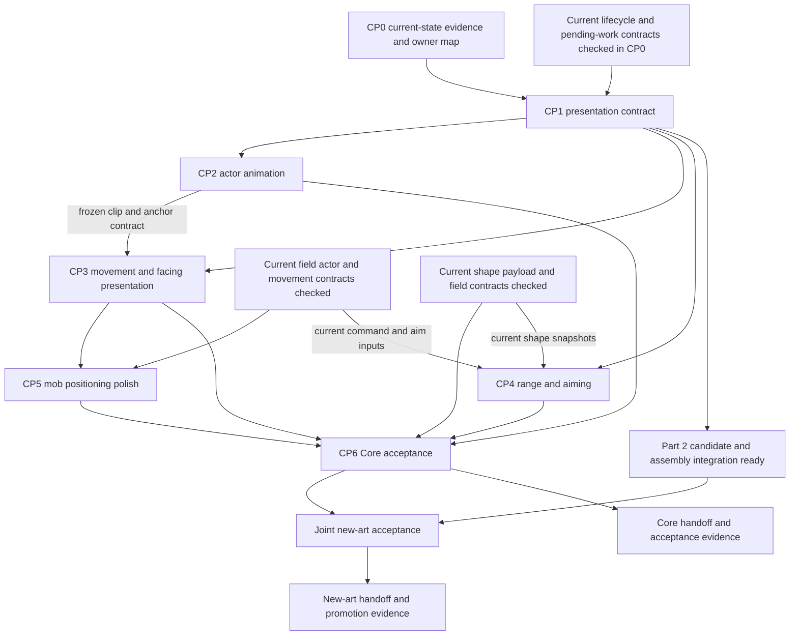

# Part 1 — Combat core engine, animation, range and mob AI

วันที่: 2026-10-26

สถานะ: **แผนออกแบบและแบ่งงาน ยังไม่ได้ implement หรือยืนยันผลใน browser**

เอกสารคู่กัน: [Part 2 — Skill VFX design and new asset generation](skill-vfx-generation-plan.md)

เป้าหมายของงานชุดนี้คือทำให้ combat เคลื่อนไหวต่อเนื่อง อ่านระยะออก และมีจังหวะเหมือนการต่อสู้ในเกม: **เลือกเป้า → เดินเข้าระยะ → หัน/ตั้งท่า → ปล่อย → กระทบ → คืนท่า → ตัดสินใจต่อ**

**การแบ่งงานตามคำสั่งล่าสุด:** Part 1 รับผิดชอบ core engine integration, actor animation, ระยะ/การเล็ง การเคลื่อนที่ และ mob AI. Agent อื่นกำลังผลิต VFX ใหม่; Part 2 เป็นสเปกออกแบบ/เจน/รับ asset และประกอบเข้ากับข้อมูลจาก core. ผู้รับงานต้องประสาน ownership ก่อนแก้ไฟล์ที่มีงานพร้อมกัน

## 1. ขอบเขตและแหล่งอ้างอิง

### 1.1 สิ่งที่แผนนี้ต้องส่งมอบ

1. Animation ของผู้เล่นและ mob ตรงกับ action จริง ทั้ง preparation, release, contact, recovery และ interruption
2. การเดิน หยุด หัน และเปลี่ยนคลิปต่อเนื่อง เท้าไม่กระโดดและไม่ไถลเมื่อควรยืน
3. ระยะโจมตี ระยะวางสกิล และพื้นที่รับผลแสดงตรงกับข้อมูล gameplay
4. AI ประชิด/ยิงไกล/ตัวหนัก/สนับสนุนมีการยืนและจังหวะที่อ่านออก รวมถึงเมื่ออยู่ในฝูงหรือริมสนาม
5. Core ส่งเวลา จุดยึด geometry และ resolved outcome ให้ VFX ใน Part 2 ได้จาก action เดียวกัน
6. Actor pose, target indication และ hostile telegraph บอกเจตนาของ action ได้สอดคล้องกับ gameplay
7. มีวิธีตรวจจุดผิดใน host จริง พร้อมเกณฑ์รับงานทั้ง correctness และคุณภาพภาพเคลื่อนไหว

### 1.2 เจ้าของความจริง

| เรื่อง | เจ้าของ |
| --- | --- |
| Workflow, first-party art, verification | [AGENTS.md](../../AGENTS.md) |
| Action lifecycle และ released work | [engine/types.ts](../../engine/types.ts), [skill-actions.ts](../../engine/skill-actions.ts), [combat-actions.ts](../../game/src/sim/combat-actions.ts), [game.ts](../../game/src/sim/game.ts) และ [pending-work.ts](../../game/src/sim/pending-work.ts) |
| Skill behavior/shape mapping ที่ใช้งานจริง | `cast`, `area`, `action`, `effects` ใน [skills.json](../../tools/data/skills.json), [skill-area.ts](../../engine/skill-area.ts) และ shared engine readers |
| Skill roster, effects, cast range, geometry และ tuning | [skills.json](../../tools/data/skills.json) |
| Attack range, movement/body settings, mob profiles | [engine.json](../../tools/data/engine.json) |
| Mob replacement skills/override kits | [mob-skills.json](../../tools/data/mob-skills.json) |
| สูตรและการคำนวณ | [DECISIONS.md](../DECISIONS.md), `engine/` |
| Gameplay contract ที่ใช้อยู่ | [game-rules.md](../game-rules.md) |
| Asset production และ spatial art direction | [vfx-production.md](../../art-reference/skills/vfx-production.md) |
| สถานะ/ตำแหน่งงาน VFX | [vfx-production-roster.json](../../art-reference/skills/vfx-production-roster.json) และ handoff ของ agent ผู้ผลิต |
| Core animation, reach, movement และ AI polish | เอกสารนี้ |
| Visual identity, component generation, atlas QC และ effect assembly | [Part 2](skill-vfx-generation-plan.md) |

ข้อมูลที่ซ้ำในตารางออกแบบด้านล่างมีไว้ช่วยอ่านสเปก ผู้ implement ต้องอ่าน owner อีกครั้งก่อนแก้และยึดตัวเลขปัจจุบันที่ owner เมื่อพบความขัดแย้ง ให้ชี้ conflict แทนการเดา damage/hit/range ใหม่

### 1.3 ขอบเขตการเปลี่ยน

- โฟกัสสนาม combat, actor animation, target/range presentation, movement/AI quality และข้อมูลส่งต่อให้ VFX
- ใช้ automatic farming กับ manual intervention ตาม command/action contract ปัจจุบัน และรักษา modular hex travel
- ใช้ runtime/renderer/Skill FX Lab ที่มีอยู่ ไม่มี gameplay scheduler หรือ renderer อีกชุดสำหรับ demo
- Formula, damage budget, proc entitlement, cost และ cooldown อยู่ canonical data/engine/sim owner; visual work เปลี่ยนผ่าน explicit scoped gameplay mutation เท่านั้น
- Itemization, progression campaign, dungeon redesign, job/card/party/PvP และ networking เป็นงานคนละขอบเขต
- การทำ obstacle navigation ต้องมี authoritative obstacle geometry ก่อน ฉากหิน/ต้นไม้ที่วาดอยู่ไม่ได้ทำให้สิ่งนั้นกลายเป็น collision
- Asset ที่กำลังผลิตเป็น dependency แบบขนาน: animation/range/AI เริ่มจาก asset ปัจจุบันได้ และรับของใหม่ผ่าน contract ที่ freeze ร่วมกัน

### 1.4 วิธี implement ที่เลือกให้ชัด

| การตัดสินใจ | วิธีที่เลือก | ผลที่ต้องได้ |
| --- | --- | --- |
| Body baseline | Player และ mob เริ่มด้วย ground diameter 0.5m, radius 0.25m; ขนาดที่ต่างต้องเป็น authored footprint override ใหม่ที่ระบุชัด | ระยะ/clearance/ภาพมีไม้บรรทัดร่วมกัน โดยไม่สืบทอดรัศมีเก่าผิดความหมาย |
| Camera math | affine transform เดียว มี point/vector/inverse functions | เมาส์ วงสกิล ทิศตัว และ projectile ใช้แกนเดียวกัน |
| Action planning | เลือก action + target + aim + movement goal เป็น decision เดียว ขยาย intent เดิม | ไม่เดินตามระยะของสกิลหนึ่งแล้วร่ายอีกสกิลด้วยเป้าคนละตัว |
| Target policy | eligibility → player rotation order → usable now → retained intent → spatial tie-break; ไม่ใช้ weighted utility กลางที่เขียนทับ rotation | Smart จากการทำตามเจตนาผู้เล่นอย่างมั่นคง |
| Decision frequency | dirty facts จาก CombatClock/event boundary; movement samples ใช้ local steering | ไม่ค้นทุก target ทุก render frame และไม่รอ world tick ถัดไปโดยไม่จำเป็น |
| Contact | รักษาจุดที่ตีได้อยู่แล้ว → retain reservation → geometry candidates → stable wait/replan | จำนวนคนเข้าถึงตัวเกิดจากขนาดพื้นที่จริง |
| Animation | pure phase remapping + voluntary-distance gait + deterministic direction selection | frame rate/seek ไม่เปลี่ยนผล animation ณ timestamp เดียวกัน |
| Delivery | actor pose, payload flight และ field lifetime แยก ownership | ยิงแล้ว actor คืนท่าได้แม้กระสุนยังเดินทาง |
| Completion | Core acceptance ใช้ current approved art/fallback; new-art joint acceptance ตาม candidate ที่พร้อม | Core เดินต่อได้ขณะที่ agent อื่นผลิต VFX |

รายละเอียดใน section 4–10 เป็น selected implementation approach ของแผนนี้. ชื่อ type/helper เป็น logical shape เพื่อ map ลง owner เดิม; ไม่ใช่คำสั่งสร้าง framework, store หรือ scheduler ใหม่

## 2. Repository reality และสิ่งที่ต้องพิสูจน์

สำรวจ source แบบ read-only ณ วันที่ข้างต้น; workspace มีงานพร้อมกัน จึงต้องตรวจ symbol ปัจจุบันใน CP0 อีกครั้ง ไม่มี baseline tests หรือ browser QC ถูกทำระหว่างเขียนแผนนี้

**Completed foundation:** ผู้ใช้ยืนยันว่าแผน combat รุ่นก่อนเสร็จแล้วและลบออก รวมถึง historical mapping ที่ไม่ใช่ runtime source. แผนนี้จึงต่อยอดจาก data/types/runtime ปัจจุบันตาม section 3 และไม่ผูกการเริ่มงานกับ milestone ของเอกสารที่ปิดงานไปแล้ว. CP0 ตรวจ current contracts/quality gaps เพื่อใช้ implementation ที่มีอยู่; การตรวจ source ในงานเอกสารครั้งนี้ไม่ใช่การรัน acceptance ใหม่แทนงานที่เสร็จแล้ว

| บริเวณที่ตรวจ | สิ่งที่พบใน source | ผลต่อแผน |
| --- | --- | --- |
| `game/src/sim/combat-arena.ts`: `approach`, `turnToward`, `separateBodies` | มี arrival easing, turn-rate cap และ body separation แล้ว | ปรับการเชื่อมกับ animation และกรณีติดขัด ไม่สร้าง movement smoothing ซ้ำ |
| ไฟล์เดียวกัน: `advanceCombatArena` | ใช้ living group ทั้งหมดแล้ว แต่ยังมี authored contact-angle slots | ข้อกล่าวหา first-three จากเอกสารเก่าใช้เป็นประวัติเท่านั้น; ตรวจ crowd/contact policy ปัจจุบัน |
| ไฟล์เดียวกัน: `sampleCombatArena` | interpolate ตำแหน่งเท้า; facing ยังมาจาก snapshot | ตรวจ discontinuity ของการหันและเลือก sprite direction |
| `game/src/ui/combat/combat-arena-view.ts`: `arenaAttackElapsedMs` | ยังมี fallback คำนวณจาก `action.atUs` และ `sheet.impactMs` | ต้องแยก timed action ที่เริ่ม windup ออกจาก legacy event ที่ atUs หมายถึง contact |
| ไฟล์เดียวกัน: `arenaActorAction` | เลือก action จาก list และยืดตาม clip end | พิสูจน์ cancellation tail และ nonblocking trigger แทรก primary pose ก่อนแก้ |
| ไฟล์เดียวกัน: `arenaEventTiming` | linked action timing มีลำดับก่อน event snapshot แล้ว | ไม่ทำซ้ำการแก้ stale-event timing ที่มีในแผนเก่า; ตรวจกรณีแก้เวลาชนจริง |
| `CombatArenaScene.svelte`: `actorView` | walk/idle ใช้ global playhead; attack/hit/death มี elapsed เฉพาะ | ออกแบบ per-actor locomotion phase และ state transition |
| Scene เดียวกัน | target highlight หา nearest sampled mob แยกจาก intent; source/target attachments มี pixel offsets คงที่ | ใช้ committed target และ measured sockets |
| `arena-space.ts`, `arena-vfx-space.ts` | มี meter conversion, ground projection และ directional footprint แล้ว | reuse projection; ตรวจทุก consumer รวมถึง radius ต่ำกว่า 1m |
| `combat-arena-view.ts`: `projectArenaPoint`, `unprojectArenaPoint`, `arenaDirection`, `arenaRangedShots` | สูตร point projection ใช้แกน Y ที่มี +8·dx แต่ inverse/direction ใช้ −8·dx; shot rotation ยังเป็น world angle | พบความขัดกันจาก source algebra; CP0 ต้องพิสูจน์ round-trip/direction แล้วแก้จาก camera matrix เดียวตาม section 4.4 |
| `combat-actions.ts`: `selectCombatIntent`; `game.ts`: `approachRange` | มี held intent แล้ว แต่ refresh aim ผ่าน nearest/cluster และยังหา approach range แยกได้ | ขยาย decision เดิมให้ movement/cast/highlight อ้างคู่เดียวกัน |
| `combat-arena.ts`: `separateBodies` | correction mob pairs แบบแบ่งเท่า และ clamp center หลัง solve | ตรวจ radius-inset bounds, collision correction กับ locomotion และ reservation validity หลัง solve |
| `game/src/sim/game.ts` | มี multi-launch/channel และ ranged flight code แล้ว | ใช้ release/impact/cancel interfaces ปัจจุบันและตรวจเฉพาะ quality gap ของงานนี้ |
| `field-area.ts`, `pending-work.ts`, `state/save.ts` | มี field/cohort/session/archive และ save-safe work แล้ว | Reuse actual ids/HP authority/save contracts; ไม่สรุปว่า full unified registry/unlimited engagement มีครบจากชื่อ module |
| VFX assets/renderers/checker | มี authored art และงานผลิตใหม่พร้อมกัน; source assumptions หลายส่วนยังต้องตรวจ | Evidence ด้าน production/assembly และทุก skill matrix อยู่ Part 2 |

**สิ่งที่เป็น hypothesis ต้อง reproduce:** wrong phase alignment, cancelled clip tail, trigger ขโมยท่า primary และ selected-target flicker. Source บอกความเสี่ยงได้ แต่ยังไม่ใช่ผลการทดสอบจริง. Empty-ground visibility/footprint distortion รับตรวจร่วมกับ Part 2

## 3. Current implementation references และ dependency ของงาน polish

### 3.1 แบ่งหน้าที่

| Contract ที่ต้อง reuse | Source/symbols ปัจจุบัน | วิธีรับในแผนนี้ |
| --- | --- | --- |
| Skill/action schemas | [engine/types.ts](../../engine/types.ts): `SkillAreaSnapshot`, `SkillCastProfile`, `SkillCastTiming`, `SkillAction` | CP1 map timed action/geometry จาก types จริง |
| Timing/contact math | [skill-actions.ts](../../engine/skill-actions.ts): `releasedSkillCastTiming`, `targetsInSkillArea`, `firstProjectileHit`; [skill-area.ts](../../engine/skill-area.ts): `skillAreaSnapshot` | CP1/CP4 ใช้ predicates/projection inputs เดียวกับ gameplay |
| Commands/intent/flight | [combat-actions.ts](../../game/src/sim/combat-actions.ts): `ManualControl`, `CombatIntent`, `CombatFlight`, selection/target helpers | CP1/CP5-A ขยาย paired decision โดยรักษา ownership เดิม |
| Event ordering/action resolution | [combat-clock.ts](../../game/src/sim/combat-clock.ts), [game.ts](../../game/src/sim/game.ts): release/resolve/cancel and mob shot paths | CP1 ใช้ integer time/comparator/receipts ที่มี |
| Actor/body/movement/snapshots | [combat-arena.ts](../../game/src/sim/combat-arena.ts): body/range helpers, `advanceCombatArena`, `sampleCombatArena` | CP3/CP5-B polish actual motion/contact ไม่สร้าง position store อีกชุด |
| Field/cohort/session/revisit | [field-area.ts](../../game/src/sim/field-area.ts): `FieldState`, `syncFieldState`, `restoreFieldPositions`, `normalizeFieldState` | ใช้ actual field/actor identities; ตรวจ `s.group` HP authority และ engagement query ปัจจุบัน |
| Pending work/save | [pending-work.ts](../../game/src/sim/pending-work.ts): snapshot/restore/normalize; [save.ts](../../game/src/state/save.ts), [sim/types.ts](../../game/src/sim/types.ts) | Save owner ตรวจ compatibility ของ geometry changes; cosmetic cache ไม่ persist |
| Mob kit/aura | [mobSkills.ts](../../game/src/sim/mobSkills.ts): `resolveMobKit`, `mobStrikeRange`, `readyMobSkill`, `applyMobAuras`; canonical mob JSON | CP5-C/D ใช้ current role/kit/aura policies |
| Actor presentation | [combat-arena-view.ts](../../game/src/ui/combat/combat-arena-view.ts), [CombatArenaScene.svelte](../../game/src/ui/combat/CombatArenaScene.svelte) | CP1–CP4 แก้ adapter/phase/transform ที่ consumer จริง |
| World-to-VFX inputs | [arena-space.ts](../../game/src/ui/combat/arena-space.ts), [arena-vfx-space.ts](../../game/src/ui/combat/arena-vfx-space.ts) | Part 2 รับ timing/footprint/socket contract จาก source ปัจจุบัน |

`field-area.ts` ปัจจุบันยังอธิบาย `s.group` เป็น combat HP authority แยก idle units และมี engagement query ที่จำกัดจำนวน. CP0 ตรวจ actual query/membership ก่อนเสนอ CP5 change; ไม่เรียกทั้งระบบว่า unlimited unified registry ที่ผ่านแล้ว. `game-rules.md` เป็น intent reference แต่บาง combat bullets ยังบรรยาย unsaved/no-collision/front-three แบบเก่า; เมื่อขัด source ให้ระบุ affected contract และใช้ current data/types/runtime พร้อมแก้เฉพาะ rule section เมื่อ implementation งานนี้เปลี่ยนจริง

### 3.2 เริ่มงานแบบซ้อนกันได้เมื่อใด



การรอ dependency หมายถึง interface/พฤติกรรมยังไม่ถูกพิสูจน์ ผู้ทำงานสามารถตรวจ source วัด asset และเตรียม visual recipe ที่ไม่แก้ shared contract ระหว่างรอได้ การสร้าง artwork ไม่ต้องรอแกนทั้งหมด แต่การ promote ต้องรอการตรวจประกอบใน host จริง

CP3 ใช้ frozen metadata contract จาก CP2 ได้ก่อนทั้ง CP2 จบ. CP5 ทำ positioning polish กับ current field/movement owner หลัง interface ตกลงกัน. CP6 Core acceptance ใช้ approved art/fallback ที่มีอยู่และ diagnostic geometry ของ renderer เดิมได้. เมื่อ Part 2 ส่ง candidate ที่ integration-ready จึงตรวจ joint new-art acceptance กับ V5; ส่ง core/new-art evidence แยกกันโดยไม่ให้เวลาผลิต artwork block การพิสูจน์ core

## 4. กติกาพื้นที่ ระยะ และขนาดภาพ

### 4.1 สามระยะที่ห้ามปนกัน

| ค่า | ความหมาย | วิธีใช้ในภาพ |
| --- | --- | --- |
| Cast range | ระยะจากผู้ร่ายถึงเป้าหรือจุดวางที่อนุญาต | เส้น/วงช่วยเล็งก่อน commit |
| Gameplay shape | single, line, cone, circle ที่ตรวจรับผลจริง | preview, telegraph, field edge และ impact coverage |
| Decorative reach | เปลว ควัน ประกาย หรือ trail ที่พ้นพื้นที่รับผล | จางลงและไม่ใช้ภาษาภาพแบบขอบ hitbox |

การตรวจ membership ใช้ `targetsInSkillArea`/`firstProjectileHit` และ action profile ปัจจุบัน: AoE ใช้ actor center ส่วน projectile contact และบางระยะโจมตีใช้ body/contact semantics ของ owner ห้าม renderer ขยายระยะด้วยขนาดภาพ mob

### 4.2 Spatial foundation — body footprint มาตรฐาน 0.5 เมตร

- หนึ่ง ground unit เท่ากับหนึ่งเมตรตาม `arena-space.ts`
- สมมติฐานล่าสุดตีความ **0.5m เป็นเส้นผ่านศูนย์กลาง ground footprint ของตัวมาตรฐาน**: `baseDiameterM = 0.5`, `baseRadiusM = 0.25`. นี่เป็น design baseline ที่จะ implement ไม่ใช่ค่าที่ source ปัจจุบันใช้ครบแล้ว
- Player และ mob ทุกตัวเริ่มที่ footprint scale 1. ตัวที่ต้องกินพื้นที่มาก/น้อยกว่าจริงต้องมี authored footprint override ที่เลือกอย่างชัดเจนใน canonical data; Small/Medium/Large/Boss, `readsAs`, rank, rarity หรือ `ps` เดิมไม่ถือเป็น override ใหม่โดยอัตโนมัติ
- `radiusM = baseRadiusM × footprintScale`; `diameterM = 2 × radiusM`. หาก owner ปัจจุบันใช้ `radius_m` โดยตรง ให้เก็บค่ารัศมีที่ resolve แล้วเป็น runtime truth เดียว ไม่เก็บ diameter/radius/scale ที่แก้แยกจนขัดกัน
- ตัวมาตรฐานสองตัวแตะขอบกันเมื่อ center ห่าง 0.5m. ช่องว่างกว้าง 1m รองรับ disk กว้าง 0.5m ได้เมื่อเงื่อนไข clearance ของ solver อนุญาต; การเดินแทรกยังต้องมี continuous valid path
- ไม้บรรทัด gameplay คือ **projected footprint ใต้เท้า**. Sprite height, chibi head/body exaggeration, weapon reach และ inspect art extent เป็น art properties แยกกัน; ไม่บีบทุก pose ให้ทั้ง PNG กว้าง 0.5m หรือดึง alpha bounds กลับไปตั้ง collision
- Radius 4m = diameter 8m; ต้องวัดบน ground plane ผ่าน projection ไม่เทียบกับวงกลม screen-space ตรง ๆ
- ดังนั้น circle radius 4m มีเส้นผ่านศูนย์กลางประมาณ 16 ตัวมาตรฐานเรียงกัน. ตัวเลขนี้อธิบายขนาด ไม่ได้หมายความว่ามีเป้าหมายได้เพียง 16 ตัว
- ยืนยัน actor scale กับ meter grid ก่อนรับ VFX ใหม่; หากตัวละครกับพื้นมี calibration ขัดกัน ให้แก้เจ้าของ projection/scale ก่อนเพิ่มขนาด effect ทีละตัว

การใช้ baseline นี้เปลี่ยน gameplay clearance จากรัศมีปัจจุบันได้จริง. CP0 ต้องอ่านค่าปัจจุบันทุก body class; CP5-B ประสาน field/movement/data owner เพื่อเปลี่ยน canonical geometry และตรวจ congestion/attack opportunity/pressure. ห้ามแก้เพียง sprite scale หรือ hardcode radius 0.25 ใน renderer แล้วอ้างว่าระบบเปลี่ยนครบ

คำว่า area ในสมมติฐานนี้หมายถึงพื้นที่ยืนที่แทนด้วย disk กว้าง 0.5m. พื้นที่เชิงคณิตศาสตร์ของ disk มาตรฐานคือ `π × 0.25² ≈ 0.19635 m²`; ไม่ใช่ area 0.5m² และไม่ใช่ radius 0.5m

**0.5m เป็น body reference ไม่ใช่ grid step.** ตำแหน่ง เส้นทาง ความเร็ว จุดร่าย และการชนยังเป็น continuous world meters. Diagnostic grid แสดงเส้นทุก 0.5m/1m ได้ แต่ไม่ปัด actor/aim ให้เป็นช่อง และไม่เปลี่ยน modular hex travel. ใช้ `1 body-width = 0.5m` เป็น derived display/debug unit ได้; runtime ยังคำนวณเมตรและไม่คูณ 0.5 ซ้ำกับค่าที่เป็นเมตรอยู่แล้ว

#### Current-to-target geometry map

ค่าด้านซ้ายอ่านจาก `engine.json`/`bodyRadiusM` ณการสำรวจ เป็น legacy geometry ที่ต้อง migrate อย่างตั้งใจ:

| Reader/data ปัจจุบัน | รัศมีเดิม (m) | Default target ในแผนนี้ (m) | วิธีจัดการ |
| --- | ---: | ---: | --- |
| `combat_arena.player_radius_m` | 0.4 | 0.25 | Resolve จาก body baseline owner เดียว |
| `mob.sizes.small.radius_m` | 0.35 | 0.25 | Size-combat classification ไม่สืบทอด radius เดิมเงียบ ๆ |
| `mob.sizes.medium.radius_m` | 0.45 | 0.25 | ใช้ standard default เมื่อไม่มีใหม่ explicit override |
| `mob.sizes.large.radius_m` | 0.6 | 0.25 | หากตัวใดต้องใหญ่จริง ให้ author footprint override พร้อม identity/เหตุผล |
| `mob.sizes.boss.radius_m` | 0.9 | 0.25 | Boss rank ไม่เลือก geometry เอง; ตรวจ actual reader ที่ปัจจุบันอ่าน `readsAs` |

ตารางนี้ไม่สั่งเปลี่ยน class damage/evasion/weapon-size multipliers. แยก footprint resolution จาก `readsAs` ที่สูตรต่อสู้อ่าน และอัปเดตทุก body reader จาก owner เดียว. หลัง migration ไม่เก็บ legacy radii เป็น implicit fallback ที่ทำให้ default ใหม่ไม่ถูกใช้

Current basic ranges melee/ranged/magic คือ 2.1/5.2/4.6m และ normal ranged projectile `hit_radius_m` คือ 0.35m. ค่าเหล่านี้เป็นคนละ parameter กับ body radius: **คงค่าและ semantics จนมี explicit owner change** ไม่ย่อทุกค่าโดยคูณสัดส่วน 0.25/0.45. ตรวจใหม่ว่าระยะอาวุธและขนาด projectile อ่านบน body ruler แล้วสมเหตุผล แต่การ tuning เป็น mutation แยกที่ระบุผลชัด

Canonical implementation เลือก owner field เดียวสำหรับ base diameter/radius แล้ว derive อีกค่า. ชื่อ field ใหม่ เช่น `body.base_diameter_m` เป็นข้อเสนอที่ต้อง map ลง schema จริงระหว่าง CP1/CP5-B; ไม่มีการ import ตัวเลขจาก plan และไม่มี renderer-local default ที่แข่งกับ data

### 4.3 Projection และระดับความสูง

1. เก็บ center, direction, length, width และ radius ใน world meters
2. Project ground points ด้วย `projectArenaPoint` ชุดเดียวกับเท้าของ actor
3. Ground circle กลายเป็น projected ellipse; line/cone project vertices จริง
4. Falling meteor/ice เก็บ ground landing point แยกจาก visual height; project landing ก่อนแล้วค่อยยก sprite ตามแกนภาพที่ตกลงกัน
5. Upright flame/bolt ใช้ขนาด/anchor ของ component ไม่บีบทั้งภาพให้เป็น ellipse เหมือน decal
6. ขอบสนามอาจ clip พื้นที่ที่มองไม่เห็น แต่ไม่ย้าย center หรือสุ่มตำแหน่งตกใหม่เพราะ camera ขยับ
7. ตรวจ radius 0, radius ต่ำกว่า 1m, line แคบ, cone ใกล้ 180° และ effect ใหญ่กว่าสนาม; ห้ามใช้ minimum visual radius ที่ทำให้ข้อมูลจริงดูใหญ่ขึ้น

### 4.4 Camera affine transform — แก้ต้นเหตุร่วมก่อน polish

จาก source ที่สำรวจ point projection เขียนได้เป็น:

```text
p_screen = c + s × A × (p_world − o)
A = [[42, 10], [8, 30]], s = 1.4
o = (9, 6), c = (1040, 530)
det(A) = 1180
```

แต่ inverse/direction helper ปัจจุบันใช้เครื่องหมายอีกชุด. ตัวอย่างที่ได้จากการแทนสูตรใน source: world `(10,6)` project เป็น `(1098.8,541.2)` แล้ว inverse ปัจจุบันให้ประมาณ `(9.880597,6.501493)`. นี่คือ **source-algebra evidence**; ยังไม่ใช่ผลรัน test/browser ในงานเขียนแผน

Selected fix design:

1. ให้ camera definition เดียวเป็นเจ้าของ `A`, `s`, `o`, `c`; derive inverse จาก matrix นี้
2. `projectPoint(p)` ใช้สูตรด้านบน; `unprojectPoint(q) = o + inverse(A) × ((q−c)/s)`
3. `projectVector(v) = s × A × v`; ไม่มี translation สำหรับ vector
4. Sprite facing, projectile orientation และ line/cone direction บนจอใช้ `atan2(projectVector(v).y, projectVector(v).x)`
5. Pointer client coordinates แปลงผ่าน actual SVG/stage transform เช่น inverse screen CTM ไป view coordinates ก่อน unproject; ไม่ใช้ client pixels เป็น 1920×1080 view units โดยตรง
6. Ground ellipse/line/cone ใช้ world points ผ่าน transform เดียว ไม่คัดลอก magic coefficients ไป component
7. Pixel rounding เป็นขั้น render สุดท้าย; inverse/geometry ใช้ค่าทศนิยมก่อน rounding

Proof ที่ต้องมี: round-trip points ภายในสนามและทุกมุม, pointer ภายใต้ stage scale/offset, unit world vectors, circle footprint และ projectile tangent. Camera sign fix เปลี่ยน visual aiming ได้กว้าง จึงทำเป็น isolated reviewable slice ก่อนแก้ AI

### 4.5 Query semantics — ใช้ค่าระยะเดียวกันต้องวัดแบบเดียวกัน

ให้ CP0 map owner functions ลงตารางนี้ และรวม helper เฉพาะส่วนที่เป็นสูตรเดียวกันจริง. `range_m` ตัวเลขเท่ากันไม่ได้แปลว่าทุก query ใช้ center/edge แบบเดียวกัน

| Query | Metric/owner ที่เลือก | สิ่งที่ห้ามอนุมาน |
| --- | --- | --- |
| Search/acquire | center distance ภายใต้ current eligible field population และ declared chase/leash policy | sprite alpha ไม่เพิ่ม search range |
| Cast placement | caster ground center → aim point ตาม cast profile | AoE radius ไม่ใช่ cast range |
| Approach | ใช้ action spatial policy ของ decision นั้น + body clearance | ไม่หา ready skill คนละตัวเพื่อกำหนดระยะเดิน |
| Basic/melee release validity | owner predicate ของ action นั้น; initial compatibility รักษา center-range readers ที่มีจน migrate แบบ explicit | ห้ามเปลี่ยน range เดิมเป็น edge range โดยคงตัวเลขแล้วแอบเพิ่ม reach |
| Single skill contact | `targetsInSkillArea`/actual contact profile ที่ใช้ precise radius ตาม owner | ไม่ใช้ weapon PNG เป็น hit radius |
| Circle/line/cone inclusion | actor center กับ committed shape ตาม selected contract | ไม่บวก body radius ให้ AoE ขยายเอง |
| Projectile sweep | swept projectile + target body radius จาก engine | ไม่ใช้ enlarged VFX glow เป็น collision |
| Body clearance | center gap ≥ radiusA + radiusB + authored clearance | ไม่เท่ากับ AoE inclusion |
| Preview/telegraph | project geometry ที่ query จริงใช้ | ไม่ใช้ minimum pretty size ทับระยะจริง |

ให้ใช้ `centerDistance(a,b)` และ `edgeGap(a,b)=max(0,centerDistance−radiusA−radiusB)` เป็นคำจำกัดความชัดเจน. การเลือก metric ของแต่ละ action อยู่ใน owner policy; helper ชื่อกว้างอย่าง `inRange` ต้องไม่ซ่อน semantic ที่ต่างกัน

### 4.6 Action spatial policy ที่ resolve ครั้งเดียว

Logical result ต่อ candidate ประกอบด้วย cast reach, hit shape, origin/aim mode, release predicate, desired stop region, body clearance และ range-reason. Resolve จาก canonical action profile ไม่คัดค่าไปเก็บใน visual recipe

- Self buff/heal ไม่มี movement target บังคับและไม่ต้องเดินเข้าระยะอาวุธ
- Caster circle ใช้ radius ในการประเมิน useful nearby targets แต่ cast point ยังเป็น caster
- Line/cone ต้องมี direction; `radius` field เก่าไม่ถูกนำมาแทน width หรือ full opening
- Ground-target point ว่างเป็น valid manual request ได้; target actor เป็น optional fact ตาม aim mode
- Default mob attack กับ replacement skill ใช้ spatial policy ของ action ที่เลือกจริง; ตรวจว่าการเช็ก basic range ซ้ำไม่ได้ทำให้ ranged skill ถูกบังคับเข้า melee โดยไม่ตั้งใจ
- หาก body clearance ไม่มีตำแหน่งที่เข้า range ตาม policy ได้ ให้รายงาน geometry conflict แทนเพิ่ม range/shrink body ใน UI

## 5. Action-to-presentation contract

### 5.1 ข้อมูลที่ consumer ต้องได้รับ

ตารางนี้เป็น **logical contract ที่เสนอ** ให้ map ลง types ปัจจุบัน ไม่ใช่คำสั่งเพิ่ม state store หรือ duplicate field ทุกช่อง

| กลุ่ม | ข้อมูลที่จำเป็น |
| --- | --- |
| Identity | arena epoch, actor id, action id, root/parent id และ impact/pulse index ที่มีอยู่ |
| Ownership | primary action หรือ nonblocking trigger; source alive/control state |
| Timing | started, released, actual impact(s), recovery end, field expiry, canceled time/reason |
| Aim | selected target, committed direction/point, release position, actual contact point |
| Geometry | authoritative shape snapshot และตำแหน่ง caster ตอน pulse หากเป็น follow-caster |
| Outcome | eligible/hit targets, hit/miss/block/crit, status/consume/cleanse facts ที่ resolved แล้ว |
| Art | actor clip/direction, attachment/socket samples และ visual recipe version |

### 5.2 Clock และ sampling

- Simulation/CombatClock ตัดสิน release, hit, resource และ death
- Scene ใช้ playhead เดียว sample actors, action phase, projectiles, field pulses และผลลัพธ์
- Render frame, CSS animation end, wall clock และ image-loaded callback ไม่มีสิทธิ์ลง damage หรือจ่าย reward
- การแก้ impact time จาก actual contact ต้องแก้ visual end/path พร้อมกัน; อย่าต่อ flight ไปยัง aim เดิมหลัง hit แล้ว
- Sampling ระหว่าง snapshot interpolate เฉพาะค่าต่อเนื่องที่ปลอดภัย; HP, status, target commitment, cancellation และ death เปลี่ยน ณ event boundary
- ไม่มี extrapolation ข้ามข้อมูลที่ยังไม่มี; เมื่อ frame สะดุดให้แสดง state ปัจจุบันตาม clock ไม่เล่น hit เก่าทั้งหมดซ้อนกัน
- Pause freeze playhead; speed change เปลี่ยนอัตราเดินของ playhead ไม่คูณ duration ซ้ำใน component
- กลับจาก hidden tab/reload rebuild presentation จากสถานะที่ยืนยันแล้ว; ไม่ replay old damage flashes/loot grants

### 5.3 Pose priority

1. Death/ended-arena จบ ordinary pose ตาม lifecycle
2. Hard-control pose ใช้เฉพาะสถานะที่ gameplay เลือกให้หยุด action
3. Primary action รักษา preparation/release/contact ที่สำคัญ
4. Hit reaction เบาเป็น bounded overlay เมื่อไม่ใช่ gameplay stagger
5. Locomotion หรือ idle ใช้เมื่อ action อนุญาต
6. Trigger aura/proc แสดง effect ของมันโดยไม่ยึด primary attack pose เว้นแต่มี explicit presentation rule

ค่า priority เป็นการเลือกภาพ ไม่สร้าง interruption ใหม่ Hard control กับ hit flash มีความหมายต่างกัน

### 5.4 Data flow และ fact ที่มีผล ณ sample time

```text
canonical data + actor/field facts
  → one decision/intent
  → CombatClock action and commitment
  → released payload / field / impact receipts
  → bounded arena snapshots and current pending work
  → pure presentation sample at t
  → actor pose + target/geometry + sockets
  → Scene and Part 2 components
```

แยกสี่สถานะข้อมูล: candidate ยังไม่ commit, committed pending work, predicted terminal time, resolved receipt. Prediction ใช้ preview/flight ได้ แต่ไม่มีสิทธิ์แสดง successful contact, HP loss หรือ death ก่อน receipt timestamp

- Sample ก่อน release ใช้ aim ที่มีผลตอนนั้น; หลัง release ใช้ committed aim
- Latest contact correction invalidate cached terminal/path ของ payload นั้น ไม่ reset ทุก actor/atlas ในฉาก
- เมื่อ playhead อยู่ก่อน contact ที่ระบบรู้แล้วจากการจำลองล่วงหน้า ต้องยังแสดง pre-contact state; global latest record ไม่เป็นสิทธิ์เปิดเผย future target/death
- Projectile position ควรอิง committed source + velocity/path time แล้ว clamp ที่ actual terminal event; การเปลี่ยน end time ต้องไม่ warp prefix ของ flight ย้อนหลัง
- Snapshot intervals ที่ข้าม spawn generation, teleport, forced displacement boundary, release/contact/cancel/death ต้อง split/mark ตาม fact นั้น; ไม่ interpolate ทุก field ตรง ๆ ข้าม discontinuity
- ใช้ existing captured frames, ids, receipts และ effective-time data ก่อนเพิ่ม revision marker. หากต้องเพิ่ม marker ให้เป็น minimal cache invalidation metadata ไม่สร้าง event-sourcing database ใหม่

### 5.5 Contract freeze checklist สำหรับ CP1

ก่อนแตก agent ไปแก้ consumer ต้องมีตัวอย่าง accepted record จาก owner สำหรับ melee, projectile, circle, channel, field และ trigger พร้อม:

| ต้องระบุ | รายละเอียดที่ต้องตรงกัน |
| --- | --- |
| Identity | actor id+generation, arena epoch, primary action id, payload/impact index; map ลง types ที่มีจริง |
| Record kind | timed new record หรือ explicit legacy contact-only; malformed new record ไม่ fall back เงียบ |
| Units | integer combat units, world meters, source-cell pixels, view pixels; ไม่มี field ที่ไม่รู้หน่วย |
| Time | actor primary end แยก payload terminal, presentation retention และ field/status expiry |
| Validity | valid-before/after release, cancellation reason/time, resolved state as-of sample |
| Geometry | shape snapshot กับ release/contact source และ target semantics ตาม section 4.5 |
| Art capability | clip/direction/marker/socket มีจริงหรือ fallback ที่ประกาศ |
| Ownership | ผู้เขียน shared files/adapter/Scene/metadata; handoff point ที่เปลี่ยน owner ได้ |

Same-time control/release/impact/recovery ใช้ comparator ของ `CombatClock`: `(atUs, priority, actorId, targetId, sequence)` และ `EVENT_PRIORITY` ปัจจุบัน. Presentation อ่าน effective outcome จากลำดับนี้ ไม่ตั้ง event-order ladder อีกชุด. ลำดับ pose priority ใน section 5.3 ไม่ใช่ลำดับ execute gameplay events

## 6. Actor animation design

### 6.1 Per-actor playback state

เก็บ state ทางภาพแบบ transient keyed ด้วย actor id + spawn generation: active clip, entered time, locomotion distance/phase, displayed direction, last primary action id และ death start. หลัง reload สร้างใหม่จาก facts ปัจจุบัน ไม่ต้องเพิ่ม save schema เพื่อเก็บจังหวะเท้า

- Walk เริ่มที่จังหวะที่เหมาะกับการออกตัว ไม่หยิบ global frame กลางก้าวแบบสุ่ม
- รอบขาอิงระยะเดินสะสมและ stride ของชุด art; ใช้ speed multiplier อย่างมีขอบเขตเมื่อคลิปมีเฟรมน้อย
- ระยะสะสมคำนวณจาก movement samples ที่ไม่ซ้ำ; render timestamp เดิมซ้ำต้องไม่เพิ่มระยะอีก และ scrub ย้อน/ไปข้างหน้าได้ phase เดิม
- Idle ใช้ phase ต่อเนื่องและ offset เชิงภาพที่ stable ต่อ actor เพื่อไม่ให้ทั้งฝูงหายใจพร้อมกัน
- หยุดเดินแล้วเข้าท่ายืนในเวลาสั้นที่ไม่เลื่อนเท้าเพิ่ม; ข้อมูลตำแหน่งยังตรง simulation
- เปลี่ยนทิศระหว่าง walk รักษา phase ของก้าว แทน reset กลับ frame 0 ทุกครั้ง
- ออกจาก scene แล้วล้าง state ของ actor ที่หมดอายุ; ต้องไม่มี map โตตามจำนวน mobs ที่เคย spawn
- บิน/ลอย/เลื้อยใช้ locomotion profile ของ art นั้น ไม่บังคับ foot-plant cycle เหมือนสัตว์สองขา

**Bounded-history checkpoint:** ที่จุดเริ่มของ presentation history ที่ยังเก็บไว้ ให้มี transient checkpoint ของ actor/arena identity, locomotion phase หรือระยะ modulo stride, selected direction และ transition seed. ก่อน trim history ต้อง advance checkpoint ไปยังขอบใหม่; seek derive/replay จาก checkpoint นี้แทนการเดาจากตำแหน่งปัจจุบันอย่างเดียว. Reload อนุญาตให้เริ่ม idle/walk ด้วย documented neutral cosmetic phase จาก pose จริงได้ โดยไม่เปลี่ยน gameplay save หรือ persist จังหวะเท้า; action phase ที่จ่ายแล้วต้องยังอ่าน actual action time ถูก

### 6.2 Phase remapping ของ attack/cast

Clip metadata ควรระบุ marker ที่อ่านได้: preparation start, release frame, contact frame เมื่อมี, recovery start/end และ foot anchor. ใช้ markers ที่มีอยู่เช่น `impactMs` เป็น legacy input ระหว่าง migration

| Phase จริง | ช่วงภาพที่ใช้ | ข้อจำกัด |
| --- | --- | --- |
| Windup | anticipation → release pose | การยืดเวลาควร hold anticipation ที่ตั้งใจ ไม่ทำให้ทุกก้าวช้าลง |
| Release | hand/muzzle/weapon release marker | projectile spawn ตรง socket ณ release |
| Melee contact | contact marker | ตรง actual contact timestamp; damage ไม่รอให้ UI วาดเฟรมนั้น |
| Projectile flight | release follow-through + independent flight | actor ไม่ค้างท่ายิงจนลูกกระสุนถึงเป้า |
| Recovery | follow-through → ready | อยู่ภายใน action interval ของ engine |
| Channel | start → active loop → finish | loop consume pulses จริง; cancellation ใช้ end reason |

เมื่อ action เร็วกว่าความยาวคลิป ให้ resample ตาม phase และรักษาภาพ silhouette หลัก ไม่เพิ่ม recovery หลัง attack interval เมื่อ action ช้ากว่า ให้ hold/loop เฉพาะช่วงที่รองรับ ห้ามยืด slash contact หลายวินาทีตาม buff duration

### 6.3 Facing และทิศของ sprite

- Interpolate มุมด้วย shortest angular path; ตรวจ crossing −π/π
- แยก actual committed aim ออกจาก sprite direction ที่ discretize เป็นทิศที่ atlas มี
- ใช้ direction hysteresis ทางภาพใกล้ sector boundary เพื่อไม่สลับเฟรมซ้าย/ขวาถี่ ๆ; tolerance นี้ห้ามหมุน hit cone
- ก่อน release ติดตามเป้าได้เท่าที่ action อนุญาต; หลัง commit ใช้ committed direction
- ตรวจทิศที่ไม่มี clip: fallback/mirror ตาม art metadata ไม่สุ่มเปลี่ยนอาวุธไปอยู่อีกมือ
- รักษา phase และ foot anchor ข้าม directional clip; mob ไม่กระโดดสูงขึ้นเมื่อหัน
- Direction hysteresis ต้อง reconstruct ได้เมื่อ seek; ห้ามให้ผลขึ้นกับจำนวนครั้งที่ browser วาด frame
- Art ปัจจุบันบางชุดมี idle หลายทิศแต่ walk/attack เพียง east/west; ทำ fallback ที่ถูกและบันทึก coverage จริง การหมุน sprite ตั้งตรงบนจอไม่สร้างท่าโจมตีแปดทิศที่ขาดอยู่

### 6.4 Transitions, hit และ death

- ใช้ pose selection/phase matching ก่อนเพิ่ม crossfade; pixel art ที่ dissolve สอง silhouette อาจดูเป็นเงาซ้อน
- Crossfade ใช้เฉพาะ art ที่รับได้ และต้องรักษาอาวุธ/เท้าที่อ่านออก
- Cancel ก่อน release จบ preparation ตาม timestamp และกลับสู่ state ที่ถูกต้อง; ไม่เล่น attack tail ต่อเพราะ `clipEnd` ยาวกว่า
- Cancel หลัง release ไม่ลบ projectile ที่ยังถูกต้องตาม lifecycle
- Hit reaction เบาอาจใช้ tint/recoil สั้นที่ visual root; ground foot point ไม่เคลื่อนหากไม่มี gameplay displacement
- Death clip เล่นครั้งเดียวและค้าง terminal pose ตาม policy; corpse มีอายุและ cleanup owner
- การฟื้นคืน/respawn ใช้ generation ใหม่ ไม่ดึง death phase เก่ามาใช้

### 6.5 Sprite/atlas QC ที่เกี่ยวกับ motion

ตรวจทุก authored frame ของ clip ที่ใช้จริง: source rect ไม่กิน frame ข้างเคียง, weapon/feet ครบ, shared anchor นิ่ง, scale ไม่เต้น, no duplicate-frame accident และ idle/walk/attack ใช้ขนาดตัวสอดคล้องกัน

การขยาย runtime cell หรือ padding ใช้แก้ framing ที่มี pixels ครบเท่านั้น ภาพที่ weapon ถูกตัดหายจาก source atlas ต้องรับ asset ที่แก้แล้วจากเจ้าของ art; metadata ไม่มีข้อมูลส่วนที่หายไปให้กู้

### 6.6 Phase sampler ที่ implement ได้ตรงกัน

ให้ adapter resolve **actor-primary timing** แยกจาก payload timing. ค่า `action.endsAtUs` ที่ใช้ retain effect/history อาจไม่ใช่เวลาที่ actor พร้อมเลือกครั้งต่อไป; อ่าน primary end จาก authoritative ownership

Logical inputs:

```text
ActionVisualTiming:
  startedAt, releasedAt, primaryEndAt
  meleeContactAt?                 # เฉพาะ pose ที่มี body/weapon contact
  cancelledAt?, cancellationKind
  primaryOwner, committedFacing

ClipMarkers:
  anticipationStart, anticipationHold?
  release, meleeContact?, recoverEnd
```

เวลาชุดแรกเป็น combat units; ชุดที่สองเป็น authored clip time. สำหรับแต่ละ semantic segment `[T0,T1)` ที่ map ไป `[C0,C1)`:

```text
u = clamp((t − T0) / (T1 − T0), 0, 1)
clipTime(t) = C0 + u × (C1 − C0)
```

Selected boundary rules:

1. ใช้ half-open intervals; ที่ `t = releaseAt` sample release marker โดยตรง
2. ถ้า `T1 = T0` step ไป marker ถัดไปโดยไม่หารศูนย์; instant cast ใช้ activation pose/contact effect ตาม owner
3. Melee map start → release → contact → primary end ตาม semantics ที่ owner ยืนยัน
4. Projectile map start → release → primary end; arrival อยู่ payload track แยก ไม่ถูกแทรกเข้า caster recovery
5. Ground cast map caster release เช่นเดียวกัน; falling object/ground strike อ่าน actual impact ของ payload
6. Markers ต้อง finite, อยู่ใน clip และ monotonic ตาม phase ของชนิดนั้น. Unknown marker สำหรับ legacy ใช้ declared fallback; new record ผิดให้ diagnostic ไม่ใช้ `impactMs=340` กลบทุกรายการ
7. ถ้า melee contract ให้ contact หลัง primary ownership จบอย่างขัดกัน ให้แก้ action/data timing ที่ `game.ts`/shared timing owner แทนยืด clip แล้วซ่อน conflict
8. Long preparation ใช้ declared hold pose/charge loop ที่รองรับ. Fast preparation resample ใน interval จริง; ไม่เพิ่มเวลาเพื่อบังคับวาดครบทุก texture frame
9. Render hitch อาจข้าม contact frame ที่จอวาดไม่ทันได้; recent resolved-impact cue ช่วยยืนยันผล แต่ไม่ replay attack ทั้งชุดหรือเลื่อน damage
10. Frame lookup ใช้ `frameMs` ปัจจุบันก่อน. เพิ่ม per-frame duration เฉพาะเมื่อ art ต้องใช้จริง แล้ว validate cumulative frame boundaries

### 6.7 Locomotion phase จาก voluntary distance

ข้อมูลที่ sim ส่งให้ presentation ควรแยกการเดินของตัวเองกับ correction/forced motion เท่าที่พิสูจน์ว่าจำเป็น. Snapshot ปัจจุบันมี position/moving แต่ยังไม่ใช่หลักฐานว่ามี movement cause ครบ

```text
movement cause = locomotion | forced | correction | discontinuity
S[i+1] = S[i] + voluntaryDistance(i → i+1)
S(t) = S[i] + u × voluntaryDistance(i → i+1)
gaitPhase(t) = fract(episodePhase + S(t) / strideM)
```

- `strideM` เป็น art locomotion metadata; movement speed อยู่ gameplay owner
- สะสม distance เมื่อ ingest simulation sample ที่ไม่ซ้ำ ไม่เพิ่มใน RAF หรือ getter ที่ถูกเรียกหลายครั้ง
- Separation correction ไม่เร่งรอบขา; knockback ไม่กลายเป็น walk; teleport/area transition เริ่ม episode ใหม่
- หาก snapshot interval มีหลาย cause ให้ split segment หรือส่งผลรวม voluntary distance จาก sim; อย่าอนุมานจาก final displacement ทั้งหมดแล้วเรียกว่าระยะเดินจริง
- เปลี่ยน direction clip รักษา phase. เปลี่ยน stride/profile ให้ rebase distance origin เพื่อคง phase ณ boundary
- Stop settle เลือก authored plant/neutral frame ใกล้ที่สุดที่ไม่ย้าย feet; actor ไม่มีเท้าใช้ locomotion profile ของตัวเอง
- Camera zoom/scale/pixel snapping ไม่เปลี่ยน `S` เพราะระยะสะสมอยู่ world meters
- Seek รองรับเฉพาะ retained window; ก่อน history floor ให้ clamp/report unavailable ตาม host ไม่ replay ประวัติทั้งเกม

### 6.8 Deterministic facing และ sparse-direction fallback

เริ่มจาก world unit direction `v=(cosθ,sinθ)` แล้วใช้ `screenθ=atan2(projectVector(v).y,projectVector(v).x)`. ห้ามคัด camera coefficients คนละเครื่องหมายเข้าฟังก์ชันเลือกทิศ

สำหรับแปด nominal sectors, sector width `w=π/4`. เมื่อ current sector มี center `c` ให้คง sector ขณะ `abs(wrap(screenθ−c)) ≤ w/2 + h`; เมื่อออกจึงเลือก sector ใกล้ที่สุด. `h` เป็น presentation tuning ที่เล็กกว่าครึ่ง sector และไม่แก้ actual cone/aim

Hysteresis ต้อง ingest authoritative samples/checkpoint หรือคำนวณ threshold crossing ใน shortest-angle segment; ห้าม update ด้วยจำนวน RAF. ใช้ tie rule เดิมเมื่ออยู่ตรงเส้นแบ่งพอดี และกำหนด deterministic fallback เมื่อมุมต่าง 180°

Capability chain ที่ต้อง inspect ได้:

```text
world aim → projected facing → requested nominal direction
  → available clip direction → metadata-approved mirror → source frame
```

การขาด directional attack เป็น art limitation ที่แยกจาก sampler correctness. Clip มีเพียง east/west ต้องใช้ fallback สองทิศอย่างตรงไปตรงมา; weapon-asymmetric art ไม่ถูก mirror โดยเดา การหันภาพ upright sprite บนจอไม่ใช่การสร้างท่าใหม่

### 6.9 Socket coordinate math และ visual launch bridge

วัด socket ใน **untrimmed runtime-cell pixels**. หากวัดบน raw atlas ให้แปลง:

```text
q_cell = q_atlas − sourceRect.origin + sourceFrame.offset
q_screen = projectGroundFoot + visualRootOffset
           + pixelScale × (mirrorSign × (q_cell.x − foot.x), q_cell.y − foot.y)
```

Apply stage/view transform ครั้งเดียวหลังจุดอยู่ใน view coordinates. Socket result ระบุว่า `measured`, `authored fallback` หรือ `neutral fallback`; diagnostic ไม่เรียกค่าที่เดาว่า measured

Gameplay projectile source เป็น ground-space fact ส่วนมือเป็น art-space point ที่สูงจากพื้น. จึงไม่ unproject จุดมือกลับเป็น ground source เพื่อเปลี่ยน range/speed. หากต้อง bridge ภาพจากมือไป path ที่ gameplay ใช้:

```text
O = socketAtRelease − project(authoritativeSource)
b = clamp((t − releaseAt) / frozenBridgeDuration, 0, 1)
visualFlight(t) = project(authoritativePath(t)) + (1 − b)² × O
```

Freeze bridge duration/curve ณ release โดยใช้ art presentation profile ที่ยืนยันแล้วและ planned release track; ไม่ normalize ใหม่ด้วย actual terminal ที่ถูกแก้ภายหลัง. เริ่มที่ socket และกลับสู่ projected path เมื่อ bridge จบ โดยไม่เปลี่ยน contact time/targets

หากเกิด early contact ระหว่าง bridge ให้จบ payload และแสดง actual contact cue ที่ resolved point/declared contact attachment ณ timestamp นั้น. อาจมี bounded terminal visual adjustment ภายใน attachment envelope แต่ห้าม warp flight prefix ย้อนหลัง. Gross offset เป็น metadata/calibration failure ที่ต้องแก้ ไม่ยืด bridge เพื่อกลบ. Sprite orientation ใช้ projected trajectory tangent รวม bridge เมื่อมี

### 6.10 Reaction arbitration ที่ตรวจได้

- Gameplay cancellation/death/control ใช้ effective receipts ของ CombatClock ก่อนเลือก pose
- Light hit ไม่ยึด full body ใน protected preparation/release/contact; ใช้ tint/recoil ที่มีขอบเขต
- Recovery ให้ reaction แทนภาพได้ตาม policy โดยไม่เปลี่ยน `primaryEndAt`
- Incoming hits พร้อมกันเลือก strongest eligible reaction ด้วย declared category → timestamp → stable event id; ไม่เลือกจาก array order
- Multi-hit coalesce visual intensity ไม่ restart full-body hit clip ทุก event จน actor ค้าง flinch
- Nonblocking proc มี overlay/action ownership ชัด ไม่ถูก `arenaActorAction` เลือกเป็น primary เพียงเพราะอยู่ท้าย global list
- เมื่อ mount/remount กลาง paid action ให้ sample phase ปัจจุบัน ไม่เริ่ม preparation ใหม่
- Generation เปลี่ยนแล้วล้าง pose/death/socket caches ของตัวก่อน แม้ species/ชื่อซ้ำ

## 7. Movement และ contact quality

### 7.1 การหยุดที่ขอบระยะ

- Movement stopping target อยู่ด้านใน valid cast/attack range เล็กน้อยตาม profile เพื่อกัน foot shuffling
- Hit eligibility ใช้ canonical range เดิม ไม่มี hidden reach bonus
- Stop/resume hysteresis เป็นข้อมูล movement policy ของ sim เมื่อเปลี่ยนพฤติกรรมจริง; visual deadband อยู่ presentation
- Target moving away, control expiry และการถูกเบียดต้องประเมินใหม่อย่าง deterministic
- Rooted windup ไม่เดินต่อ; mobile channel ใช้ `CombatIntent.mobile/speedMult` และ current action movement policy

### 7.2 Contact positions ในฝูง

1. ใช้ body radii กับพื้นที่ว่างจริงเลือกตำแหน่งเข้าตี
2. รักษา reservation/ตำแหน่งที่ยังใช้ได้ เพื่อลดการแย่งช่องทุก movement sample
3. ตรวจ bounds และ clearance หลัง separation; ตำแหน่งที่เลือกต้องโจมตีถึงจริง
4. เมื่อช่องตัน เลือกตำแหน่งอื่นที่เข้าถึงได้ หรือรอในระยะที่ไม่แทรกตัวซ้ำ
5. ให้ moving bodies รับ correction มากกว่าตัวที่กำลังยืนออก action เมื่อ solver ปัจจุบันรองรับ โดยยังรักษา authoritative collision policy
6. ไม่ใช้ teleport หรือ pixel offset ซ่อนการซ้อนตัวที่ gameplay ยังทับกัน

การเพิ่ม reservation/steering ใด ๆ อยู่ CP5-B ร่วม current field/movement owner ต้องวัดผลต่อ attack opportunity และ throughput ไม่ถือว่าเป็น cosmetic ล้วน

### 7.3 กรณีที่ต้องผ่าน

- ผู้เล่นติดขอบ, mob ใหญ่ขวางทาง, melee หลายขนาดแย่ง contact
- Ranged อยู่หลัง melee, เป้าตายระหว่าง approach, เป้าสองตัวมีระยะเกือบเท่ากัน
- Actor เริ่ม/หยุดซ้ำ, ถูก slow ระหว่างเดิน, ถูก hard stop ก่อน release
- Spawn ตรงจุดที่ body อื่นใช้อยู่; ผู้เล่น local move ผ่านฝูงภายใต้ collision policy
- ไม่มีเป้า valid: เข้าสู่ idle/return ตาม state จริง ไม่เดินวนจาก fallback target ที่ไม่มีอยู่

### 7.4 Contact reservation algorithm

Reservation เป็น **สิทธิ์ใช้ตำแหน่งสำหรับการเข้าถึงตัว** ไม่ใช่สิทธิ์โจมตี. Attack ยังต้องผ่าน range/action/control predicate จริงทุกครั้ง และไม่มี cap จากลำดับ array

Logical reservation มี owner actor+generation, target id+generation, desired world point, body radius, goal version, last-valid time และ blocked-since. เก็บร่วม authoritative field/movement structures ที่ CP1 ตรวจจาก `field-area.ts`/`combat-arena.ts`; ไม่สร้าง actor/HP store ใหม่

ลำดับ solve ต่อ decision epoch:

```text
1. Remove only reservations whose actor/target/arena is invalid.
2. Retain a clear current position when the actor can already attack there.
3. Retain an existing reservation that still satisfies geometry and intent.
4. Order unassigned contenders by waiting-since, travel distance, stable identity.
5. Generate valid candidates; reserve the best one, or enter stable waiting state.
6. Integrate movement and separation; validate reservations against final positions.
```

Candidate region รอบเป้าหมาย:

```text
lowerCenterGap = radiusSelf + radiusTarget + authoredClearance
upperCenterGap = maximum center distance permitted by this action's metric
contact annulus = points whose gap lies in [lowerCenterGap, upperCenterGap]
```

- Body baseline 0.5m ทำให้ standard-standard lower gap เริ่มที่ 0.5m เมื่อ clearance=0
- Standard radius 0.25m กับ explicit large radius 0.5m มี lower gap 0.75m เมื่อ clearance=0; scale 2 เป็นตัวอย่างการ resolve ไม่ใช่ override ที่แจกให้ Boss ทุกตัวอัตโนมัติ
- Desired point ใช้ stop inset ภายใน valid annulus; ถ้ายืนถูกอยู่แล้วไม่บังคับอ้อมไป preferred ring
- ถ้า lower > upper ให้ emit `geometry-infeasible`; ต้องแก้ action/body profile ที่ owner ไม่ลด radius หรือเพิ่ม reach ใน solver
- Candidate disk ทั้งก้อนต้องอยู่ใน radius-inset bounds และไม่ซ้อน retained reservations
- เริ่มจาก bearing เข้าหาเป้าที่สั้นที่สุด, current valid point, previous reservation และ tangent alternatives ข้างพื้นที่ที่ถูกจอง. Refine angular candidates เฉพาะช่วงที่ยังอาจมีที่ว่าง; ไม่เริ่มด้วยสามมุม fixed แล้ว reuse จนชน
- Candidate set มีขอบเขต: retained/current/direct-bearing points, reservation tangencies และ inset-bound intersections; adaptive subdivisions มี canonical budget และ stable order. Budget หมดให้ `contact-blocked`/`search-budget-exhausted` แล้วรอ relevant epoch ไม่ค้นไม่สิ้นสุด
- เมื่อ candidate อยู่ที่ target-relative radii `di,dj` ตรวจ clearance ด้วย world distance จริง: `distance(pi,pj) ≥ ri+rj+clearance`. ใช้ law of cosines สร้าง angular exclusion/tangent ได้; ไม่ใช้จำนวน mob เป็นเหตุผลให้ปิดโจมตี
- Lexicographic candidate preference: feasible → retained/current position → shortest valid travel → smallest reservation change → stable angle/id. ไม่บวก utility weights ลับที่อาจทำให้เดินอ้อมเพื่อคะแนนสูง
- เคารพ target leash/farm anchor และ direct/local-steer reachability ของ model ปัจจุบัน. Candidate endpoint ว่างไม่ได้พิสูจน์ว่าเส้นทางไปถึงว่าง
- ไม่พบ candidate ให้ `contact-blocked` พร้อมคง target/คิว; เลือก waiting position ที่ไม่ปิดทาง หรือ local tangent waypoint ที่ valid
- Target เดินแล้ว update reservation relative geometry ใน budget ที่กำหนด; ไม่ย้ายทุกตัวข้ามด้านเพื่อเรียงวงให้สวย

### 7.5 Movement integration และ correction evidence

Selected pipeline:

```text
one decision + action/control locks
 → desired movement toward goal
 → bounded integration to next CombatClock/event sample
 → body/bounds constraints
 → final authoritative positions
 → range/contact validation + voluntary/forced/correction evidence
 → presentation sampling
```

Bounds ของ disk radius `r` ที่ต้องอยู่ในสนามทั้งตัวคือ `[r,width−r] × [r,height−r]`. Goal generation และ correction ใช้ domain เดียวกัน; clamp center หลัง solverอย่างเดียวทำให้ overlap กลับมาได้

- รักษา stable pair ordering; body ร่วมศูนย์ใช้ normal จาก stable pair identity ไม่ผลักทุกคู่ไปซ้ายด้วย fallback เดียว
- Initial correction weights รักษา semantics เดิม: player ไม่ถูก soft separation ผลักโดย mob, mob pairs แบ่ง correction เท่ากัน. ลดการเบียด committed attacker ด้วย reservation/steering ก่อนเสนอ mass-weight change
- ถ้าจะเปลี่ยน weights ให้เป็น canonical movement policy ที่ CP5-B และ field owner review เพราะเปลี่ยน attack opportunity; action lock ไม่ให้ immunity ต่อ actual forced movement
- หลัง bounded pass ตรวจ overlap residual, bounds residual และ attack-validity; solver budget หมดแล้วให้ explicit congestion reason แทนวนจนจบโดยไม่มีเพดาน
- Event gap ยาวต้อง integrate ผ่าน existing movement cuts. หาก actor speed ทำให้ relative travel ใหญ่กว่าขนาด body ให้ subdivide หรือใช้ swept-body handling ที่ owner ยืนยัน; substeps อย่างเดียวไม่ใช่ข้อพิสูจน์ว่ากัน tunneling ได้ทุกกรณี
- Cosmetic gait อ่าน self-moved distance; final correction อ่านเป็น correction. ถ้าไม่มี movement cause ที่พอแยก ให้เพิ่ม minimal fact ณ movement owner ไม่ใช้ rendererเดา
- Corpse ที่เป็น render-only ไม่กลายเป็น body blocker เว้นแต่มี authored gameplay contract

### 7.6 Stop/resume state และ stuck recovery

Ordinary ranged ใช้ selected policy:

```text
Approaching:
  move toward preferred stop while no permitted attack opportunity is being released
  if an attack opportunity is due and canonical max range is valid: stop and fire
Holding:
  target still within max range → hold and fire
  target outside max range → resume approach
```

เลือก interpretation ให้ชัด: preferred 80% เป็น steering goal ไม่ใช่เงื่อนไขห้ามยิง. Actor ที่เริ่ม decision ใน maximum range ยิงจากตำแหน่งปัจจุบันได้; actor ที่เดินมาจากนอกระยะเดินเข้าหา preferred region ระหว่างรอ attack opportunity. หาก opportunity มาถึงเมื่อเพิ่งเข้า maximum range ให้หยุดยิงได้ และหลัง recovery ยังอยู่ใน range ให้ hold ต่อ ไม่เดินต่อเพียงเพื่อบังคับให้ถึง 80%. จึงไม่ได้รับประกันว่าทุกตัวจบที่ 80%; การคง cadence/valid opportunity มีลำดับก่อนการจัดระยะที่สวย

Target เข้ามาใกล้ไม่ทำให้ ordinary ranged ถอย. Melee ที่อยู่ใน range และ clear ให้ hold/attack; เลื่อนตำแหน่งเมื่อ geometry/intent invalid จริง. Stop inset/hysteresis ไม่เพิ่ม maximum reach

Stuck probe ใช้ simulation time และ goal version เดิม:

```text
requested movement > 0
AND not already usable from current position
AND no action/control lock explains the wait
AND goal-relative progress stays below movement tolerance over the probe window
```

แยก target ที่กำลังหนีออกจาก stationary blockage; ระยะถึง moving goal ไม่ลดไม่ได้แปลว่า solver ค้างเสมอ. ใช้ projected progress ไปยัง goal ณ sample เดียวกัน ร่วมกับ requested/actual displacement และ correction

Recovery ladder:

1. ตรวจ usable-now จากตำแหน่งจริงอีกครั้ง → hold/attack ถ้าถึงแล้ว
2. ตรวจ owner/target/bounds และปล่อยเฉพาะ reservation ที่ invalid
3. ลอง tangent candidate ฝั่งที่มี clearance โดยรักษาด้านที่เลือกไว้จน invalid เพื่อกัน left-right oscillation
4. ถ้ายังตัน → stable wait พร้อม retry ที่ eligible decision epoch; oldest waiter ได้พิจารณาก่อน
5. Invalidate ว่า unreachable เฉพาะ owner predicate พิสูจน์ได้ เช่น feasible annulus/domain ว่าง, forbidden leash region หรือ authoritative reachability query ปฏิเสธ. Local candidate budget หมดหรือ congestion ชั่วคราวยังไม่ใช่ proof ของ global unreachable
6. ไม่ teleport, เร่ง movement ชั่วคราว, ignore body หรือให้ free attack เพื่อแก้อาการค้าง

Probe window, movement tolerance และ candidate retry policy เป็น canonical movement tuning ที่ต้องเลือกจาก CP0 fixtures. Initial derivation ใช้ movement-step duration กับเวลาที่ใช้เดินประมาณหนึ่ง body radius; บันทึกค่าที่ resolve ใน packet ไม่ผูกกับ render frames หรือ hardcode timeout แยกใน UI

### 7.7 เหตุผลที่ body baseline ต้องตรวจร่วม encounter pressure

การลด/เพิ่ม disk เปลี่ยนจำนวนตัวที่ยืนรอบ target ช่องที่เดินผ่านได้ และเวลาที่ mobs เข้าถึงผู้เล่น แม้ damage formula เท่าเดิม. จึงเก็บ observations ก่อน/หลัง: contact access, actual attack opportunities, time spent approaching/blocked, incoming damage และ resource use

ไม่รักษาจำนวนสามตัวเข้าตีด้วย hidden index gate และไม่เพิ่ม monster damage ชดเชยเอง. CP5-B เป็น owner ของการประเมินผล spatial opportunity; current engagement query/cap ต้องอ่านจาก `field-area.ts` และเปลี่ยนเฉพาะเมื่อ packet ระบุไว้; roster size/reward/formula ยังเป็น data ของมัน

## 8. Target, range preview และ telegraph

### 8.1 รูปแบบแสดงผลที่เลือก

| สถานะ | สิ่งที่แสดง |
| --- | --- |
| Auto farming ปกติ | เป้าปัจจุบันและ action ที่กำลัง commit; ไม่เปิดวงระยะทุกสกิลพร้อมกัน |
| เลือก/เล็งสกิล | cast range แบบเบา + footprint ที่จุด/ทิศเล็ง + valid/invalid state |
| รอเดินเข้าระยะ | จุดที่ขอไว้และเหตุผล range; ภาพไม่หลอกว่า cast ออกแล้ว |
| Windup | พื้นที่/ทิศตามกติกาที่ติดตามได้ พร้อม cue การเตรียม |
| Released | committed geometry คงที่สำหรับ fixed-ground/line/cone; follow-caster ใช้กติกาของมัน |
| Impact/field | พื้นที่รับผลจริงและอายุที่เหลือแบบอ่านออก |
| Enemy heavy threat | preparation cue + committed danger shape ตามเวลาและการเปลี่ยน aim จริง |

Single-target แสดงการเลือกตัว ไม่วาด circle ใหญ่รอบ enemy จนดูเป็น splash. Line ใช้ full width, cone ใช้ full opening angle ไม่สับสนกับ half-angle. Circle แยกขอบเขตจาก glow

### 8.2 ความถูกต้องของ target indication

- Highlight source จาก current intent/committed action; nearest mob ใช้ได้เฉพาะเมื่อ policy เลือกมันจริง
- Focus ที่ผู้เล่นปักไว้กับ target ของ action ปัจจุบันอาจต่างกันระหว่างรอจบ commitment; ภาพต้องบอกความต่างโดยไม่แสดงว่า action เปลี่ยนแล้ว
- Target ตายหลังปล่อย projectile: แสดงเส้นทาง/ผลตาม delivery จริง ไม่ย้าย effect ไปหา nearest body ด้วย UI
- Manual ground cast บนพื้นที่ว่างยังแสดง preparation, release และ effect ตาม action ที่จ่ายแล้ว แม้ targets=[]
- Miss/dodge/block ไม่ควรมี successful-hit flash แบบเดียวกับ HP loss; คง effect หลักตาม delivery และแยก result cue

### 8.3 Inputs และ readability

- ใช้ command pipeline/keyboard actions เดิม; cancel aim ไม่สร้าง cast
- ตรวจ hover, keyboard aim/confirm/cancel และ read-only tab โดยไม่เปลี่ยน writer rules
- ใช้รูปร่าง/ลวดลาย/จังหวะร่วมกับสีแยก friendly/hostile/invalid
- Telegraph ของ ordinary basic ไม่รบกวนทั้งสนาม; heavy tagged threat ได้ visual priority
- การเล็งและ range display ไม่ query hidden future state/RNG เพื่อบอกว่าศัตรูจะ dodge หรือ crit

### 8.4 Aim solver และ feasibility pipeline

แยก `requestedAim`, `liveAim`, `committedAim` และ `resolvedContact` เป็นคนละ semantic fact โดย reuse fields/types ที่มีตาม CP1

1. Pointer/keyboard request แปลงเป็น world aim ด้วย section 4.4; เก็บ requested point ที่ผู้เล่นเลือก
2. Validate actor ownership/weapon/control/resources และ aim mode แบบ pure query ไม่ spend/roll
3. สร้าง current shape snapshot จาก current source/aim เพื่อ preview และ usable-now check
4. หากยังไกล สร้าง approach goal ที่ทำให้ requested aim เข้า cast range โดยไม่เลื่อน requested point ไปหา enemy อื่น
5. อนุญาต live tracking เฉพาะ target เดิมและ phase ที่ gameplay อนุญาต
6. Release freeze source/aim/direction/geometry ตาม contract; renderer อ่าน committed values
7. Contact อ่าน actual impact/targets ณเวลาจริง; preview ไม่เป็นหลักฐานว่าทุก actor ที่เคยอยู่ในวงต้องโดน

Auto shape targeting ใช้ candidate enumeration ที่มีขอบเขต:

- Single: retained target ก่อน nearest eligible replacement; ไม่ให้ renderer acquire
- Ground circle: เริ่มจาก eligible actor centers ตาม policy เดิม; ประเมิน center-in-circle ด้วย engine helper. Arbitrary optimal point placement เป็นการเพิ่ม AI policy ที่ต้อง review แยก ไม่แอบเพิ่มจาก visual pass
- Caster circle: ตรวจ actor centers ภายในพื้นที่ปัจจุบัน; เมื่อยังไม่ถึง สร้าง approach จาก target ที่เลือกและรักษาคู่นั้น
- Line/cone: เริ่มจาก bearing ไป retained/eligible target และ boundary bearings ที่จำเป็น; ประเมิน actual shape membership ด้วย helper เดียว ไม่ใช้ round-radius count ประเมิน cone
- Manual focus มีลำดับก่อน auto cluster policy ตาม `CombatIntent`/current command handling; line/cone direction request ไม่ถูกเปลี่ยนด้วย cluster solver หลัง commit

Planning targets ที่ใส่ primary เพื่อบอกว่าจะเดินเข้าหา แยกจาก `eligibleNow` ที่ hit/release ใช้. ไม่ให้ออบเจ็กต์ approach ที่ยังอยู่นอก shape นับเป็น hit เพื่อเปิด `minTargets`, consume, proc หรือ damage

### 8.5 หนึ่งเหตุผลรอที่ actionable

Eligibility/intent ส่ง reason enum แบบ bounded ให้ inspector/host: `no-target`, `out-of-range`, `contact-blocked`, `cooldown`, `resource-floor`, `weapon`, `condition`, `controlled`, `primary-committed`, `returning`, `invalid-aim`, `geometry-infeasible`

ให้ primary reason มาจากขั้นตอนที่ block จริง พร้อม values เช่น actual distance/max/preferred. ไม่สร้างข้อความจาก animation ที่เห็น และไม่เปลี่ยน OR trigger legs ให้กลายเป็น AND เพื่ออธิบายง่ายขึ้น

## 9. Mob AI และภาษาท่าทาง

### 9.1 State ที่ต้องอ่านออก

`idle/home → acquire → approach → prepare → release → recover → evaluate` และ `return`, `controlled`, `dead` เป็น logical behavior/presentation mapping ในแผนนี้; map ลง current action/control/field facts ตาม section 3

State เหล่านี้ใช้ authoritative behavior ที่มีอยู่ map เป็นภาพ ไม่จำเป็นต้องสร้าง state machine ซ้ำใน UI. ตัวละครที่รอ cooldown ควรอยู่ใน ready pose; ไม่เล่น fake attack เพื่อเติมเวลา

### 9.2 Behavior profiles

| Profile | การเดิน/ยืน | Animation และ feedback | เกณฑ์รับ |
| --- | --- | --- | --- |
| Melee | เข้าตำแหน่ง contact ที่ใช้ได้ หยุดแล้วตี | หันเข้าหาเป้า มี preparation สั้นและ follow-through | อาวุธถึงเป้า เท้าไม่ไถล ไม่ orbit |
| Ordinary ranged | stand and fire ตาม `combat_arena.normal_attack.profiles.ranged.stop_at_range_pct` | หัน/ยกอาวุธ ปล่อยที่ muzzle แล้วคืนท่า | ไม่เดินเข้าประชิดทั้งที่ยิงได้ ไม่ถอยทุก tick |
| Skirmisher | bounded backstep เฉพาะ profile ที่เลือก | backstep แตกต่างจาก forward walk ถ้า asset รองรับ | จำกัดตาม cadence/ระยะที่ canonical กำหนด ไม่ kite สมบูรณ์แบบ |
| Heavy | เข้า reach แล้ว commit strike | anticipation ชัด, strike ทิศที่ล็อก, recovery ที่อ่านออก | ไม่เปลี่ยนท่าฟันตามผู้เล่นหลัง commit |
| Support/aura | รักษาตำแหน่งที่มีประโยชน์ตาม AI ที่ author | source aura และ eligible allies อ่านออก | visual ไม่เพิ่ม healing/buff หรือระยะใหม่ |
| Return/home | disengage และกลับ home ตาม declared field policy | ลด threat cue ตาม actual state | ไม่ยิงฟรีขณะ reset; HP reset/entitlement ต้องผ่าน current field/reward owner |

### 9.3 Cadence และ fairness

- Default attack กับ replacement skill ใช้โอกาสโจมตีเดียวกันตาม owner
- Skill ใช้ไม่ได้ไม่ทำให้ ordinary archer ลืมยิงหรือเดินเข้าระยะ melee โดยไม่จำเป็น
- Preparation/recovery อยู่ใน cadence จริง; animation ไม่เพิ่มความถี่การโจมตี
- Sticky target และ deterministic tie-break ลด target oscillation
- Ordinary projectile ไม่เปลี่ยนเป็น homing จาก visual smoothing
- ความสามารถหลบ/ถอย/ควบคุมใช้ explicit profile; mob ไม่รู้ผล RNG หรือคำสั่งผู้เล่นที่ยังไม่ commit
- Leash/assist/aggro/aura radius ใช้ current authored gameplay policy ที่ CP0 map จาก data/runtime; หาก profile ยังไม่ author ให้ระบุ proposed change ใน CP5 ไม่เพิ่ม radius เพื่อให้ภาพฝูงดูแน่นขึ้น

### 9.4 One decision envelope — skill, target, aim และ movement ไปด้วยกัน

ขยาย `CombatIntent`/movement input ที่มีอยู่ให้ผู้ใช้ทุกคนอ่านผลตัดสินใจเดียวกัน. รูปนี้เป็น logical output ไม่ใช่คำสั่งสร้าง planner/store ใหม่:

```text
CombatDecision:
  actor + arena + generation
  source: manual | rotation | default | return
  action/profile reference
  target reference?              # optional สำหรับ self/ground aim
  requested/live aim reference
  spatial policy reference
  movement goal + reservation? + goal version
  phase/commit ownership + reason
  decidedAt + next relevant fact/boundary
```

Movement ไม่เรียกหา ready skill เพื่อสร้าง range อีกครั้ง. Release ไม่เรียก nearest เพื่อเปลี่ยน target อีกครั้ง. Scene ไม่เดา target จากระยะอีกครั้ง. ทุก consumer อาจอ่าน live position ของ **identity ที่เลือกแล้ว** ตาม phase ที่อนุญาต

### 9.5 Player selector แบบ lexicographic ที่รักษา rotation

```text
decide(actor, now):
  reject ended arena/dead actor
  apply due control/cancel facts using existing event order
  process manual request under current commitment/cancel rules
  if primary ownership still blocks a new action:
    retain current action; update only permitted tracking/movement
  else if eligible manual move/cast exists:
    retain its aim/request; build one decision
  else:
    choose first usable-now row in player's rotation order
    else if held approach remains usable:
      evaluate permitted higher-priority/better-cluster replacement
      use qualifying replacement, otherwise retain held action+target
    else:
      use permitted fresh approach/default opportunity or acquire/idle/return
```

คำว่า usable-now รวม ownership, weapon, resources/protected floor, cooldown, trigger conditions, target/shape และ actual range. Self buff/heal ไม่ต้องสร้าง hostile target ปลอม. Empty manual ground placement ใช้ permitted point ได้

- ห้าม score `expected DPS` กลางมาแซง slot order หรือเปลี่ยน OR trigger semantics
- Useful in-range row ได้โอกาสก่อนเดินต่อไปหาสกิลที่ยังยิงไม่ได้ตาม policy ปัจจุบัน
- Held target ยัง valid ให้รักษาไว้; permitted live tracking อัปเดตตำแหน่ง target เดิม ไม่เรียก nearest ใหม่
- Better-cluster switch เปรียบ shape membership ของ action/eligibility class เดียวกัน; planning-primary ที่ยังนอกวงไม่นับเป็นประโยชน์ที่โดนแล้ว
- Usable-now row, manual command, hard invalidation และ newly ready higher-priority row ใช้ approved ordering ทันที ไม่รอ soft-switch confirmation
- เลือกให้ CP5-A author confirmation เฉพาะ **soft better-cluster approach switch** ที่ยังไม่ commit ใน canonical movement policy; initial tuning คือสอง existing movement observations พร้อม compatibility evidence. ก่อน packet นี้ promote ใช้ strictly-better cluster rule เดิม; promote config/consumer พร้อมกัน ไม่ให้ UI เพิ่ม hidden delay เอง. การตรวจ derive จำนวนจาก resolved policy ไม่ใช้เลขสองเป็น balance gate ถาวร
- ระยะเท่ากันใช้ stable identity หลัง policy ordering. Queue-order tie ที่ต้องรักษา compatibility ให้เก็บใน adapter period ชัดเจนระหว่าง CP5-A เปลี่ยน current target query
- Basic fallback ใช้ accumulated attack opportunity เดิม; ไม่ reset progress เพื่อ retry หลายครั้ง ณ timestamp เดียว หรือยิง basic พร้อม skill ที่ใช้ opportunity เดียวกัน
- Manual request ที่ยังไม่ commit มีได้หนึ่งรายการตาม `ManualControl`; request ใหม่แทนรายการเก่าตาม current command policy ไม่สร้าง hidden combo queue

### 9.6 Decision epochs และ cache invalidation

Full acquire/cluster query เกิดเมื่อมี dirty reason ที่เกี่ยวข้อง:

- Action completed/canceled หรือ primary ownership เปลี่ยน
- Target ตาย, generation/arena/eligibility เปลี่ยน, หลุด leash หรือ reachable policy invalid
- Range/shape membership ข้าม boundary ที่ทำให้ eligibility เปลี่ยน
- Cooldown/resource/status/condition เปลี่ยนจน row ที่เกี่ยวข้อง usable ต่างจากเดิม
- Manual command, engagement membership, reservation invalidation หรือ stuck probe confirmed
- Pending soft-switch confirmation boundary ที่ author ไว้: เก็บ challenger/goal version + nextRelevantBoundary แล้ว revalidate เมื่อถึง existing clock/movement sample นั้น; challenger หมดข้อได้เปรียบให้ cancel. จึงมีการตรวจครั้งถัดไปแม้ geometry membership ไม่เปลี่ยน และไม่สร้าง wall-clock timer

Movement advance และ projectile sweep ยังเกิดที่ existing clock/event cuts. Local steering อ่าน retained decision ระหว่าง full decisions; renderer ไม่ trigger dirty event. เมื่อหลาย reasons เวลาเดียวกันให้ coalesce query หลัง due facts ของ event ordering นั้น ไม่ execute cast หลายครั้งเพราะ dirty หลายบิต

Cache key ใช้ actor/action/arena generation กับ relevant fact version ที่ owner มี. ถ้ายังไม่มี versions ให้ใช้ explicit invalidation ที่จุด mutation ก่อนเพิ่ม dependency/version framework ใหญ่. Cache ไม่เก็บผล RNG และ speculative query ไม่ spend/cooldown/consume status

### 9.7 Mob opportunity selector และ action locks

เลือก replacement skill ที่ใช้งานได้จริง ณ permitted opportunity:

```text
if invalid / controlled / incompatible committed action:
  record no-release reason under cadence policy
else:
  strike = first kit entry valid by cooldown + role + live target + spatial policy
  candidate = strike or valid normal attack
  start exactly one primary action if candidate exists
```

- Entry แรก ready แต่ out-of-range → ตรวจ later usable entries แล้ว default; ไม่ให้ speculative kit choice บังคับ archer เข้า melee
- Cooldown/payment commit ตาม shared lifecycle ของ action ที่ออกจริง; planning future kit schedule ไม่ใช้เป็นหลักฐานว่า cast เกิดแล้ว
- Windup เริ่มได้ข้าม world-second boundary. Telegraph ไม่ถูก clamp ให้เริ่มต้น tick เพื่อรีบ land ใน tick เดิม
- Basic anticipation/recovery อยู่ใน attack cadence เดิม; ไม่สร้าง second cooldown และไม่ให้ basic+strike ใช้ opportunity ซ้ำ
- Mob movement ต้องอ่าน primary action/control locks เช่นเดียวกับผู้เล่น. Heavy ยืน commit และ locked direction ตาม profile; ordinary ranged hold/fire
- Ranged projectile อ่าน aim ตอน release และ actual swept contact; friendly mob bodies ไม่เพิ่ม collision rule ใหม่
- Explicit skirmisher เป็น opt-in profile ใน CP5-D: initial close threshold 40% ของ basic range, retreat budget ไม่เกินระยะที่เดินได้ใน 25% ของ current attack interval, ไม่เกินหนึ่งครั้งระหว่าง released attacks. Author ค่านี้ใน canonical policy ก่อนเปิดใช้; เมื่อไม่มี profile ให้ ordinary hold/fire. Retreat point ไม่ valid ให้ hold/attack ไม่เลือก flee ต่อเนื่อง
- Aura-only support แสดง source/recipient ที่มีจริง. Support movement/retreat ใหม่ต้องมี explicit profile และ CP5-D field/AI owner; ไม่เพิ่ม behavior จากชื่อ role
- Enemy perception อ่าน facts ที่ profile อนุญาต ณเวลานั้น; ไม่อ่าน future player command, future hit result หรือ RNG เพื่อหลบ/ยิงดักแบบสมบูรณ์

### 9.8 Bounded avoidance และ safe-point selection

Proposed policy ของ CP5-D ใช้เฉพาะ tagged heavy committed ground threat. Author canonical reaction delay/cooldown ก่อนเปิดใช้; initial design คือ reaction 0.25s และ reposition cooldown 2s พร้อม action locks/manual priority ตาม current lifecycle. หาก current profile ไม่มี behavior นี้ ให้ถือเป็น explicit gameplay extension ของ packet ไม่ใช่ระบบที่สรุปว่ามีแล้วจากแผนเก่า

1. เมื่อ threat visible และ committed ให้เก็บ threat id/geometry/time; reaction เริ่มตามข้อมูลที่รับรู้ได้จริง
2. สร้าง nearest outside candidates จากขอบ circle/line/cone และ local bounds ที่ body ยืนได้
3. Candidate ต้องอยู่นอก actual membership predicate + numerical tolerance ไม่บวก body radius ให้ damage shape เปลี่ยนเอง
4. ตรวจ body clearance, leash และ reachability ภายใน movement time ที่เหลือ
5. เลือก travel สั้นที่สุด แล้ว stable tie-break; หากหลาย threats ทับให้ตรวจ union ของ relevant committed threats
6. หากไม่มี valid/reachable outside point ให้ action/defense ทำงานตามปกติ ไม่ teleport/immune/guarantee dodge

ผู้เล่นไม่ใช้ automatic avoidance กับ ordinary targeted projectile ทุกลูก. การ cancel rooted preparation/channel เพื่อขยับต้องจ่ายผลลัพธ์ตาม unpaid/paid policy เดิม; ไม่มี free movement ระหว่าง committed attack

### 9.9 Local decision trace ที่ใช้วินิจฉัยได้

ใช้ bounded read-only dev inspector บน host เดิม ประกอบจาก current state/history; ไม่มี telemetry service หรือการ persist debug log ลง save

```text
arena / actor generation / primary action / payload / impact identities
phase + started/released/contact/primary-end timestamps
chosen action + target + decision reason + dirty reason
actual range metric/value / maximum / preferred stop
requested aim / committed aim / actual contact
goal version / reservation / waiting time
requested travel / voluntary distance / external correction / overlap residual
accepted or withheld attack opportunity + reason
art direction/frame/marker/socket quality and fallback
```

Counters แยก target switches ตาม reason, reservation changes, range enter/exit, blocked time และ reaction coalescing. ค่าพวกนี้ใช้ชี้ต้นเหตุและเทียบ before/after; ไม่กำหนดว่าบิลด์ต้องทำ DPS/clear time ตามตัวเลขตายตัวจึงผ่าน

## 10. Core interfaces และขอบเขตการแก้ source

### 10.1 Pure presentation adapter

เสนอให้มีจุดแปลงเดียวจาก sampled actor + current primary action + resolved events ไปเป็น actor presentation sample. เริ่มจาก `combat-arena-view.ts` และ helper ปัจจุบันก่อนตัดสินใจแยก module

Output เชิงความหมายควรมี:

- Actor identity/arena epoch และ action ที่เป็นเจ้าของ pose
- Clip, phase, direction, source-frame index และ clip elapsed time
- Ground feet, visual root offset และ sampled attachment sockets
- Cancellation/death/control visibility และเหตุผลที่เลือก pose
- Target/committed aim reference สำหรับ target marker และ range presentation

Adapter ต้องเป็น pure sampling หรือมี cache ที่ reconstruct ได้; ห้ามใช้เพื่อเลือก skill, ปรับ cooldown, ย้าย body, roll RNG หรือให้ attack permission. Shared action/field/pending types เปลี่ยนโดย Core integration owner คนเดียวตาม section 10.3

### 10.2 Socket contract ให้ Part 2

| Socket | ความหมาย | กติกา fallback |
| --- | --- | --- |
| Feet | จุดยืนบน ground plane | ใช้ shared actor anchor ที่วัดแล้ว |
| Body/chest | จุดรับผลบนลำตัว | ใช้สัดส่วนของ authored body extent ไม่รวมอาวุธ |
| Cast hand | ต้นทาง charge/release | ถ้าไม่มี hand track ใช้ declared body-relative point ที่ stable ต่อ art family |
| Weapon/muzzle | ตำแหน่งปล่อย projectile/weapon trail | sample frame/direction ณ release; mirror ตาม metadata |
| Contact attachment | จุดแสดง body hit | ใช้ actual contact เป็นฐาน แล้ว apply bounded visual offset เมื่อจำเป็น |

Track เป็นข้อมูล art/presentation ไม่แก้ projectile collision origin หรือ reach โดยเงียบ ๆ หาก visual muzzle กับ authoritative launch origin ต่างจนอ่านผิด ให้ owner ทั้งสองตกลง representation ที่ถูกตาม action contract

- Socket offsets ต้องอยู่ใน virtual sprite coordinates ที่อิง source rect/anchor เดียวกัน
- Scale, mirror และ camera projection ต้องถูก apply ในลำดับเดียวกับ actor
- การเปลี่ยน clip ต้องไม่ทำให้ charge เด้งข้ามตัวหรือหลุดอาวุธ
- Socket ของ source ที่ตายหลัง release ไม่ได้เป็นสิ่งจำเป็นต่อ released projectile ที่ freeze source แล้ว
- Fixed-ground field ไม่มี dependency ว่าต้องหา source DOM element เจอทุก frame
- Part 2 ขอ socket เพิ่มผ่าน contract นี้; ไม่ใช้ค่าคงที่ `y - 58`/`y - 48` เป็นสเปกถาวร

### 10.3 File ownership ที่แนะนำ

| Surface | เจ้าของงาน | ข้อควรระวัง |
| --- | --- | --- |
| `game/src/sim/game.ts`, `types.ts`, `combat-actions.ts`, `combat-arena.ts`, `field-area.ts`, `pending-work.ts` | Core integration owner คนเดียวในช่วงเดียวกัน | ตรวจ current handoff/shared-file owner ก่อน edit |
| `engine/skill-actions.ts`, shared types, canonical JSON | Gameplay/data owner | ไม่เพิ่ม geometry/formula สำเนาใน UI |
| `combat-arena-view.ts`, actor presentation helpers | Animation/presentation owner | ใช้ accepted action contract และส่ง helper ให้ Scene |
| `CombatArenaScene.svelte` | Scene integration owner | รับ contributions เป็น pure helpers/props ก่อนแก้ร่วมหลายคน |
| Actor art metadata / sockets | Actor-art owner ร่วม animation owner | วัดจริง; version/migration ของ metadata ต้องรองรับชุดเก่า |
| `ArenaSkillVfx*`, authored registry/manifest, asset QC | Part 2 integration/production owner | รับ core inputs; ดู ownership ใน Part 2 |
| `App.svelte`, showcase host, keyboard commands | Host owner | หลีกเลี่ยงหลาย agent แก้ไฟล์ orchestration พร้อมกัน |
| `game/src/state/save.ts` และ pending/field serializers | Save/compatibility owner | Presentation cache ไม่เข้า save; gameplay additions ต้องตรวจ migration |

ตำแหน่งข้างต้นคือ source ที่พบหรือชื่อกลุ่มที่มีอยู่ ไม่บังคับสร้างทุก helper แยกไฟล์. เมื่อมีเจ้าของไฟล์อื่นกำลังแก้ ให้ตกลง interface/handoff ก่อน merge เนื้อหาใน workspace เดียวกัน

## 11. Readability, feedback และ performance ของ core

### 11.1 สิ่งที่ต้องตรงเวลาเดียวกัน

สำหรับ melee ให้ actor contact pose ตรงกับ melee impact. สำหรับ projectile/delayed-ground ให้ caster release pose ตรงกับ release ส่วน payload contact ตรงกับ actual impact. Hit cue, HP/status transaction, hit number และ death อ้าง resolved impact เดียวกันตามผลจริง. การแสดงบนจอมี display-frame quantization ได้ แต่ไม่ใช้ timestamp คนละชุดหรือเพิ่ม damage delay เพื่อรอ animation

- Numeric HP/state เป็นค่าจริง ณ event; หากแถบ HP ใช้ visual tween ต้องวิ่งเข้าหาค่าปัจจุบันและไม่แสดงความเสียหายอนาคต
- Consecutive hit visuals รวมความเข้ม/จำนวนได้เพื่อลดความรก โดยยัง inspect actual event แต่ละอันได้
- Hit reaction ที่ไม่ได้เป็น gameplay stagger ไม่เปลี่ยน movement/attack eligibility
- Damage text ไม่เกิดซ้ำจากทั้ง event adapter และ VFX component
- Death/reward ไม่รอให้ corpse fade; corpse fade ไม่จ่าย reward
- Inspect hitbox/nameplate ครอบ authored art reach โดยไม่กลายเป็น collision footprint

### 11.2 Feedback ที่ให้ Part 2 รับต่อ

- เสียง/impact emphasis bind ด้วย action/impact id และ category เดียวกับภาพ
- Crit, block, dodge, ES absorption และ immunity มี cue ต่างกันตาม facts จริง
- Camera shake/flash เป็นทางเลือกและมี cap/coalescing; ordinary multi-hit ไม่กระตุกกล้องทุก fragment
- Hit emphasis ใช้ presentation-only offset/brightness; CombatClock, input และ save writer ไม่ถูก freeze
- Missing sound asset ไม่ block animation/range/AI completion; ใช้ existing sound owner หากมี และรักษา settings

### 11.3 Render/simulation budget

- เก็บ snapshot/history ที่จำเป็นต่อ sampling แบบ bounded; actor ที่ despawn แล้วไม่ทิ้ง cache ถาวร
- ตรวจ repeated action scan ต่อ actor ต่อ frame เมื่อจำนวน subhits เพิ่ม; index/cache โดย identity เมื่อมี evidence ว่าจำเป็น
- Body separation ปัจจุบันมี all-pairs work; profile ก่อนเปลี่ยนเป็น spatial indexing และคง deterministic result/ordering
- Pixel snapping ใช้หลัง common projection/scale; อย่า round actor กับ socket คนละวิธีจนสั่นแยกกัน
- เป้าหมาย presentation 60 Hz บนเครื่อง reference ที่ระบุในการตรวจ; บันทึก frame pacing, sim work และ burst/backlog แยกกัน
- ค่าประสิทธิภาพตามเครื่องเป็น observation ไม่ใช่ assertion ใน ordinary correctness tests
- Quality reduction ปิด decoration ก่อน actor/telegraph/contact; ไม่มีการทิ้ง gameplay event เพื่อให้ภาพลื่น
- ตรวจ 1× และ speed options ที่เกมรองรับจริง รวม overlapping fields/auras; normal-speed readability เป็นเกณฑ์สำคัญ

### 11.4 Accessibility และ control

- Reduced motion ลด recoil/rotation/shake/strobe แต่ยังมี attack phase, target, footprint และ contact cue
- ใช้ shape/pattern/timing ช่วยสีสำหรับ danger, friendly, invalid aim และ results
- Keyboard focus/aim/cancel ใช้ระบบเดิม; animation ไม่ขโมย focus
- Pause, panel open/close และ read-only inspection ไม่ consume gameplay RNG หรือเปลี่ยน target state

## 12. Execution packets

สถานะต่อไปนี้เป็น dependency assessment ของแผน ไม่ใช่หลักฐานว่า code ผ่านแล้ว. **CP0 เริ่มแบบ read-only ได้ทันที**; packet ถัดไปรับเป็นงาน implement ได้เมื่อ predecessor interfaces/behavior ถูกตรวจและเจ้าของไฟล์พร้อม

### CP0 — Evidence, current contracts และ ownership

สถานะ: **READY สำหรับ read-only discovery**

- Objective: ยืนยันสิ่งที่ runtime ทำแล้วและ reproduce ปัญหาที่เหลือ โดยไม่เขียนระบบซ้ำ
- อ่าน `startWindup`, release/contact/cancel paths, `arenaActorAction`, `arenaAttackElapsedMs`, `sampleCombatArena`, Scene `actorView` และ normal mob flight/skill paths
- ตรวจ actual actor art direction/clip coverage และ frame/foot/socket metadata
- Reconcile current sources ใน section 3: action ids, release/impact ownership, fields, HP authority และ pending-work boundaries; รักษางาน foundation ที่เสร็จแล้ว
- ทำ owner map ของ shared orchestration files กับทีมที่กำลังทำ core/VFX
- เลือก reproducible fixture จาก host เดิม: melee, ranged interception, ground circle, burst/channel และ crowd ที่ขอบ
- Handoff: ตาราง confirmed/reproduced/unknown พร้อม symbols และ actual fixture controls; ใช้ gate output เป็น run record ไม่สร้าง transcript/report ถาวรเพิ่ม
- Stop condition: ไม่มี critical source/interface หรือมี owner conflict ที่แก้โดยอ่าน handoff ไม่ได้ ให้ระบุ path/symbol/dependency ที่ขาด

CP0 ต้องปิด uncertainty ตามลำดับความเสี่ยง:

1. Camera point/inverse/vector consistency และ pointer-to-ground path
2. Current body radii → proposed standard diameter 0.5m พร้อมรายชื่อ explicit size overrides
3. Timed-vs-legacy action identity, primary end, cancellation และ as-of playback
4. Range predicates ที่ใช้จริงใน approach/release/contact และ mob kit selection
5. Contact reservation/bounds/correction evidence และ missing directional/socket metadata

ผล reconcile ใช้สี่สถานะ `already implemented`, `mismatch reproduced`, `absent`, `unverified` ต่อ requirement พร้อม path/symbol/owner. ห้ามใช้ comment หรือ plan เก่าแทนหลักฐานว่าระบบปัจจุบันขาดอยู่

สำหรับ body migration ให้รายการต่อ actor/profile ระบุ `old radius → new default/explicit override → actual reader → affected contact/projectile/spawn/bounds/save consumer`. Existing `readsAs` ไม่เป็นหลักฐานว่าเลือก override ใหม่แล้ว. ตรวจ active positions/respawn spacing และ footprint overlays ร่วมกัน โดยคง progress/receipts และใช้ save owner จัดการ compatibility

### 12.1 Contract freeze outputs และ integrated proof slices

CP1 ส่ง accepted record examples, units/identity/geometry map, owner map และ scenario controls ตาม section 5.5. ใช้ source types/fixtures ที่มีอยู่เป็น artifact ไม่ต้องสร้างเอกสารซ้ำอีกชุด. ผู้รับ dependent work ต้องอ่าน shape เดียวกันก่อน edit

หลัง contract ขั้นต่ำพร้อม ให้ทำ vertical proof เร็วตามลำดับนี้ โดยใช้ approved art เดิม:

| Slice | สิ่งที่ประกอบจบในสนามจริง | Scope ที่ review ได้ | Gate ก่อนขยาย |
| --- | --- | --- | --- |
| VS-A Camera + one melee | Pointer/projected target → paired intent → approach → face → plant → contact → recovery | Camera adapter + minimum CP1/CP2/CP3 actor path; ไม่เพิ่ม mob profile | Round-trip ถูก, contact/HP ตรง, cancel/fast cadence ไม่แตก |
| VS-B One ranged | Stand/fire → socket release → real flight → interception/miss → result | CP1/CP2 socket + normal ranged path และ renderer เดิม | Caster recovery แยก arrival, target/source death ไม่เปลี่ยน committed path |
| VS-C Shape/aim | Single/line/cone/circle preview → requested/committed aim → actual membership | CP4 + engine geometry ที่มี; ใช้ diagnostic footprint ใน Scene เดิม | Empty manual cast, radius ต่ำกว่า 1m, all quadrants, invalid aim |
| VS-D Crowds | Mixed body sizes → reservations → steering/correction → valid attacks | CP5 target/contact/opportunity changes ร่วม current field/movement owner | No hidden reach/ghost attack และ blocked reasons ตรวจได้ |
| VS-E Burst/field/channel | Per-launch/pulse identities → fixed/mobile centers → interruption/recovery | Current `CombatFlight`/shape/field contracts + core adapter; รับ candidate VFX เมื่อพร้อม | ไม่มี count-based fake hits หรือ primary pose ถูก field ยึด |
| VS-F Roster/production | ทุก live actor/profile/skill binding ใน actual host | CP6 sweep + Part 2 joint acceptance ตาม candidate | แยก core/art/quality/performance results ชัด |

VS-A/B/C ใช้ subsets ของ CP2–CP4 แล้วพิสูจน์ร่วมกันก่อนทำ whole-roster expansion; ไม่รอให้ทุก subsystem เขียนเสร็จจึงเชื่อมครั้งแรก. Shared `game.ts`/Scene changes รวมโดย integrator เดียว; contributors ส่ง helper/type/metadata ที่ขอบเขตชัด

### CP1 — Freeze presentation inputs และ timeline adapter

สถานะ: **DEPENDENT — CP0 ยืนยัน current action/timing/pending contracts และ shared-file ownership แล้ว**

- แยก timed action จาก legacy contact event อย่าง explicit; ยุติการเดา `atUs` แบบเดียวสำหรับทุก action
- Map primary ownership, phase milestones, cancellation และ trigger overlay ลง pure presentation sample
- ใช้ current action timing เมื่อ actual contact แก้เวลา/จุด; immutable resolved snapshots อยู่กับ receipt ของมัน
- Freeze socket/geometry/outcome props ที่ Part 2 ต้องรับ โดยร่วม review กับ VFX integration owner
- Normalize camera/range semantics และ as-of fact binding ตาม section 4.4–4.6/5.4–5.5 ก่อนให้ consumer คัดสูตรเอง
- ปรับ legacy fallback เฉพาะ record ที่ไม่มี timing จริง; ห้าม fallback กลบ malformed new records
- Acceptance: timestamp เดิมให้ clip/frame/pose เดิม; cancel ไม่เล่น tail; nonblocking trigger ไม่ขโมย primary; flight contact ไม่ออกผลซ้ำ
- Evidence required: focused cases จาก existing owner tests เมื่อมีการทดสอบที่ได้รับอนุญาต และ phase stepping ใน actual host

### CP2 — Actor clip timing, reactions และ art metadata

สถานะ: **DEPENDENT — CP1 + metadata contract**

- ทำ piecewise windup/release/contact/recovery mapping ตาม section 6
- สร้าง coverage matrix ต่อ actor/clip/direction โดยอ่าน roster ปัจจุบัน ไม่ hardcode จำนวน species/variant
- วัด foot/body anchors, release/contact markers และ sockets ที่จำเป็น; มี declared fallback สำหรับ metadata เก่า
- ป้องกัน flinch กลบ release; coalesce repeated reactions; death เล่นครั้งเดียว
- ตรวจ missing/partial frames ที่ทำให้ crop/weapon jump; ส่งข้อผิดพลาดไป actor-art owner พร้อม clip/frame ที่เจอ
- Implement phase equations/degenerate-marker rules และ explicit art capability lookup ตาม section 6.6–6.10; ไม่รับ marker/atlas ที่ผิดด้วย generic timing fallback
- Acceptance: cadence ช้า/ปกติ/เร็วรักษาจังหวะจริง, no added recovery, rooted pose ไม่ไถล, inspect art extent ครบ
- จบเมื่อ runtime mapping ถูกและข้อจำกัด art ที่ยังขาดระบุรายตัว; อย่ารายงาน missing direction ว่า complete จาก mirror เพียงอย่างเดียว

### CP3 — Locomotion phase, facing และ stable transitions

สถานะ: **DEPENDENT — CP1 + frozen clip/anchor metadata contract จาก CP2; ไม่ต้องรอทั้ง CP2 จบ**

- Distance-based walk phase, per-actor entry/stop policy, stable idle offset
- Shortest-arc facing interpolation, projected direction selection และ sector hysteresis
- Derive/rebuild state ให้ pause/seek/reload ไม่ขึ้นกับ render call count
- แยก pose offset จาก ground feet และชนิด actor ที่ไม่มีเท้า
- Acceptance: start/stop/reverse/slow/control/target-death และ direction boundary ไม่กระตุก/สั่น; attached socket อยู่กับ actor
- เปรียบ continuous playback กับ backward/forward seek หลัง trim history รวม actor เดินวนกลับจุดเดิมและ facing ใกล้ sector boundary; phase/direction ต้องตรง checkpoint policy
- ถ้า position correction ใหญ่จาก crowd solver ให้ส่ง root cause ไป CP5 แทนการซ่อนด้วย tween ยาว
- Initial VS-A ต้องเห็น foot planting ด้วย actual frames; generic sinusoidal whole-body lunge ที่ทำให้เท้าเคลื่อนทั้งที่ actor ยืนควรถูกแทนด้วย authored pose/weapon attachment ที่ถูก ไม่ชดเชยด้วย shadow ลอยคนละจุด

### CP4 — Target, aim, range และ committed threat presentation

สถานะ: **DEPENDENT — CP1 + current `SkillAreaSnapshot`/`targetsInSkillArea` และ command path ที่ตรวจแล้ว**

- Current target/focus/committed aim อ่านจาก command/action เดียวกัน
- แสดง cast reach แยก single/line/cone/circle footprint และ valid/invalid state
- ใช้ full width/full opening/radius ตาม snapshot; project ground vertices จริง
- แสดง manual ground cast บน empty permitted ground แม้ outcome ไม่มี hit targets
- Hostile heavy telegraph บอก tracking/lock/impact ตาม lifecycle; ordinary attacks คงภาพอ่านง่าย
- Acceptance: boundary ±epsilon, radius ต่ำกว่า 1m, moving primary, empty point, line/cone ทุก quadrant และ keyboard cancel
- ไม่มีการย้าย target/change radius โดย presentation; ถ้า data/intent ขัดกันให้แก้ owner ก่อน
- Verify actual pointer mapping ผ่าน stage scale/inverse projection ก่อนปรับ range art size; ถ้าจุดเล็งไม่ตรงเพราะ transform ให้แก้ transform ก่อน

### CP5 — Mob approach/contact positioning และ role quality

สถานะ: **DEPENDENT — current field/actor/movement contracts ที่ CP0/CP1 ตรวจ + CP3 locomotion evidence; ไม่รอ milestone ของแผนเก่า**

- รักษา target commitment, valid contact position และ preferred stop policy
- Reuse actual body radii; แทน fixed slot reuse เมื่อมันสร้าง blockage ด้วย policy ที่ accepted main design รองรับ
- รักษา ordinary ranged stand/fire และ explicit bounded skirmisher; default/replacement attack cadence เดียวกัน
- ปรับ preparation/recovery expression ของ heavy และ support source/recipient cues
- ตรวจ crowd/bounds/large body/re-hit return-home; ไม่มี ghost attack จากตัวที่ยังเข้าระยะไม่ได้
- วัดผลต่อ attack opportunity, survival, resource use และ farm throughput; เปลี่ยน spawn/reward tuning คนละ owner
- Acceptance: no endless approach/orbit/slot thrash, archer ยิงได้เมื่อ valid, melee เข้าถึงได้, separation ไม่ทำให้ striker หลุด range ทุกครั้ง

แบ่ง CP5 เป็น reviewable mutations ที่ไม่ชนกัน:

| Subpacket | Algorithm ที่ใช้ | Changes ที่ถือเป็น gameplay | Proof |
| --- | --- | --- | --- |
| CP5-A Decision/target | Section 9.4–9.6: paired intent, dirty epochs, sticky target, rotation-preserving order | Target switch/approach opportunity เปลี่ยนได้; วัด reason และ compatibility | Near-equal targets, cooldown readiness, focus, no-resource fallback |
| CP5-B Body/contact | Section 4.2/7.4–7.7: baseline 0.5m, reservations, inset bounds, correction/stuck ladder | Clearance/access/pressure เปลี่ยนจริง; canonical data + field/compatibility review | Feasible/infeasible annulus, corners, mixed sizes, dead reservation cleanup |
| CP5-C Mob opportunity | Section 9.7: first actually usable kit entry/default + common lifecycle | Attack selection/locks/cross-tick preparation; preserve cadence/budget | Ready short-range entry + later usable entry, default fallback, source controlled |
| CP5-D Avoidance/expression | Section 9.7–9.8 + explicit heavy/support/skirmisher profiles | ระบุ current-versus-proposed policy และ author config ก่อนเปิด; ไม่ให้ทุกตัว kite/dodge | Committed heavy threat, action locks, no reachable safe point, manual priority |

Integrator คนเดียวรวม orchestration. CP5-A/B/C ทำ independent helper analysis พร้อมกันได้ แต่ shared sim/types/data mutations ต้องมี accepted interface และลำดับ merge/handoff ใน workspace เดียวกัน

### CP6 — Integrated scene, feedback และ roster sweep

สถานะ: **DEPENDENT — CP2–CP5 + verified current payload/shape/field facts. New VFX candidates เป็น dependency ของ joint stage เท่านั้น**

- **CP6-Core:** เชื่อม Scene, actor samples, sockets, actual projectile contact, hit results, field phase และ death โดยใช้ current approved art/fallback และ renderer diagnostics ที่มีอยู่
- ขยาย real showcase/lab fixtures จาก primitives เดิม เพื่อ pause/step/seek และดูแต่ละ outcome ได้
- ตรวจผู้เล่นและ mob ทุก art/profile ที่ live roster ใช้; representative fixture ไม่แทน whole-roster sweep
- ตรวจ 1×/accelerated/pause/hidden-tab/reload/read-only takeover และ reduced motion
- ตรวจ production bundle/asset loading และ frame pacing ในสนามจริง; บันทึกข้อจำกัดที่ยังเปิด
- ส่ง core handoff โดยแยก gameplay correctness, art completeness, presentation quality และ performance evidence
- **CP6-Joint:** เมื่อ Part 2 candidate/assembly พร้อม ให้ตรวจ new-art integration ร่วม V5 ต่อ skill/family. Core complete ไม่ทำให้ candidate ที่ยัง pending ผ่านเอง และ candidate ที่รอ producer ไม่ย้อน block CP6-Core
- รายงาน Core correctness complete / art integration pending แยกกันได้; final new-art acceptance ยังต้องมีหลักฐานของส่วนที่ pending นั้น

## 13. Verification และ integrated acceptance

### 13.1 งานเอกสารครั้งนี้

ตรวจเนื้อหา ลิงก์ local, skill-id coverage ใน Part 2, dependency names และการแบ่ง ownership เท่านั้น. ไม่มีคำอ้างว่าการเขียนแผนทำให้ combat/VFX ผ่าน tests หรือ browser แล้ว

### 13.2 Existing owner tests สำหรับ implementation ภายหลัง

ใช้ tests/fixtures ปัจจุบันก่อนเพิ่มชุดใหม่ และเลือกตาม affected behavior:

- `game/tests/combat-arena-view.test.ts`: clip phase, selection, facing, sampling
- `game/tests/combat-arena.test.ts`: movement, body separation, bounds/contact
- `game/tests/combat-presentation.test.ts`: action/outcome to presentation
- `game/tests/combat-timing.test.ts`, `combat-clock.test.ts`: lifecycle/cadence/ordering
- `game/tests/skill-area.test.ts`, `arena-space.test.ts`: membership/projection/range
- `game/tests/mob-skills.test.ts`: replacement skills/telegraphs/aura behavior
- [pending-work.test.ts](../../game/tests/pending-work.test.ts): current paid-work restore, offline/area exit และ player/mob flight contracts
- [field-area.test.ts](../../game/tests/field-area.test.ts): field identity, cohorts/session, slot/positions และ archive/revisit
- [boss-arena.test.ts](../../game/tests/boss-arena.test.ts): current local arena epoch และ return-to-field behavior
- [combat-acceptance.test.ts](../../game/tests/combat-acceptance.test.ts): existing build/encounter and aura integration evidence
- Actual default-projectile/interruption tests ที่มี ณ CP0: ตรวจไฟล์ก่อนอ้างชื่อ เพราะ agent อื่นกำลังเพิ่มได้
- Authored rendering/asset tests อยู่ Part 2 เพื่อไม่ให้เจ้าของสองชุดสร้าง validation ซ้ำ

คำสั่งสำหรับรอบ implement/verify ที่ได้รับมอบหมายภายหลัง:

```powershell
npm run typecheck
npm --prefix game run check
npm --prefix game run test -- tests/combat-arena-view.test.ts tests/combat-arena.test.ts tests/combat-presentation.test.ts
npm --prefix game run build
```

เลือก focused tests เพิ่มจาก affected owners เมื่อมีการขอทดสอบ/verify implementation. Cross-layer changes ใช้ relevant cages และ broaden ตาม AGENTS.md; ไม่รันทั้ง suite จากการแก้เอกสารนี้. Gameplay contract/wiki เปลี่ยนจริงจึงแก้ section ที่เกี่ยวข้องและ `npm run wiki`

### 13.3 Live inspection host

- ใช้ dev server เดิม port 5173; ตรวจ port ก่อนเริ่ม และรักษา server ที่มีเจ้าของอยู่
- สนาม: `http://localhost:5173/__showcase?sample=arpg-arena&sprite-preview=pixel-v2`
- เลือก species/variant/skill จาก host ปัจจุบัน; ตรวจ query controls ที่มีจริงก่อนเพิ่ม parameter ใหม่
- Isolated effect: `http://localhost:5173/__showcase?sample=skill-fx&skill=attack.meteor`; เป็นตัวช่วย phase/anchor ไม่ใช่หลักฐาน scale ในสนาม
- Integrated inspection ที่ **1920×1080** ตาม AGENTS.md; ใช้หนึ่ง visible task tab และปิดหลังตรวจ
- เมื่อ browser/capture ใช้ไม่ได้ ให้รายงานข้อจำกัดและแยก source/DOM evidence จาก visual proof; ไม่สร้าง mirror/headless renderer ทดแทน

### 13.4 Acceptance scenarios

| กรณี | สิ่งที่ต้องเห็น/ตรวจ | Owner |
| --- | --- | --- |
| Basic melee | approach → plant → weapon contact → recovery ตาม interval | CP2/CP3/CP5 |
| Ordinary ranged basic | หยุดระยะเหมาะ ปล่อยจาก muzzle และ hit/miss ตรง path | CP1/CP2/CP5 + Part 2 |
| Melee + ranged mixed pack | contact ไม่อุดตัน และ archer ไม่เดินเข้าประชิดเมื่อยิงได้ | CP5 |
| Target death during approach/windup | เปลี่ยน state ตาม commitment ไม่มี attack ลมที่ถูกนับโดน | CP1/CP5 |
| Projectile interception | actual body/contact/time เดียวกัน; flight เก่าจบ | CP1 + Part 2 |
| Source death after release | actor ตาย แต่ payload ยังอยู่ตาม valid-arena policy | CP1/CP2 + Part 2 |
| Hard stop before release / during channel | pose/remaining pulses/cost ตาม lifecycle ไม่กลายเป็น free cast | CP1/CP2 |
| Cosmetic received hit | ไม่ลบ primary release หรือเปลี่ยน cadence | CP2 |
| Nonblocking trigger | effect ออกได้โดย primary clip ไม่ถูกแทน | CP1/CP2 + Part 2 |
| Circle/line/cone | preview, committed shape และ actual eligible points ตรงกัน | CP4 |
| Empty-ground manual cast | มี action/effect ตามการจ่ายจริง ไม่มี fake target | CP4 + Part 2 |
| Fixed field / mobile channel | fixed center คงที่; moving center ตาม caster/pulse policy | CP1/CP4 + Part 2 |
| Large bodies at each corner | reachable contact และ stable clearance ไม่มี endless sliding | CP5 |
| Direction ±π / sector boundary | ไม่หมุนอ้อมวงและไม่สลับ sprite ถี่ | CP3 |
| Sparse directional art | fallback สอดคล้อง feet/weapon; รายงานทิศที่ยังขาด | CP2/CP3 |
| Fast/slow actual attack modifiers | ภาพอ่าน release/contact ได้และไม่มี added gameplay recovery | CP2 |
| Pause/speed/seek | timestamp เดิม = phase เดิม; ไม่เพิ่ม event จาก render | CP1/CP3 |
| Hidden-tab/reload/takeover | ไม่มี replay storm/reward duplication; cache reconstruct ถูก | Current save/pending-work owner + CP6 |
| Reduced motion | ยังคง target/threat/area/contact; ลด shake/rotation | CP4/CP6 + Part 2 |
| Full authored art reach | weapon/feet ไม่ถูก crop; nameplate/inspect ใช้ art extent ถูก | CP2/CP6 |

### 13.5 Observable diagnostics และ negative cases

ตัววัดเหล่านี้ทำให้คำว่า smooth/stable ตรวจได้โดยไม่สร้าง balance quotas:

| Diagnostic | Invariant/ความหมาย | ตัวอย่าง failure ที่ต้องจับได้ |
| --- | --- | --- |
| Point round-trip error | `distance(world, unproject(project(world)))` อยู่ใน numerical tolerance ที่ระบุ; initial double-precision fixture tolerance 1e-6m | ผิด camera sign, ใช้ client pixels แทน view units |
| Projected vector/tangent error | Direction ตรงกับ projected path; ไม่นำ world angleไป rotate SVG ตรง ๆ | Arrow ชี้คนละแนวกับ flight |
| Action boundary delta | Marker/receipt อ้าง timestamp เดียว; display-frame quantization แยกจาก logical delta | Caster ถือท่ายิงจนลูกกระสุนถึง หรือ slash เกิดก่อน windup |
| Sampling determinism | Same retained timestamp → same frame/direction/socket/phase โดยไม่ขึ้นกับจำนวน sample calls | Gait เดินเร็วขึ้นที่ 144 FPS หรือ hysteresis ต่างหลัง seek |
| Foot/socket residual | เปรียบ measured anchor กับ projected foot/socket หลัง deliberate transforms; stable pixel-art idle/plant target ภายในหนึ่ง output pixel | Frame trim ทำมือ/เท้ากระโดด; generic lunge ขยับ planted feet |
| Target switch reason | ทุก switch มี allowed invalidation/manual/rotation/cluster reason | Nearest ต่างเล็กน้อยทำให้ target flip |
| Reservation churn | Retained valid point ไม่ถูกปล่อยโดยไม่มี reason; blocked time มี owner | ทุก mob ย้าย slot ทุก sample หรือ ghost reservation หลังตาย |
| Body/bounds residual | Feasible fixture มี clearance/bounds ถูก; infeasible fixture มี explicit congestion/geometry reason | Center อยู่ในขอบแต่ disk ล้น หรือ solver push/clamp วน |
| Opportunity withheld reason | ทุก skipped opportunity อธิบายด้วย actual gate; หนึ่ง opportunity ไม่ออกสอง primary | Entry สั้น out-of-range แล้ว archer ยืนนิ่งทั้งที่ basic ยิงได้ |
| Motion decomposition | Gait ใช้ voluntary travel; forced/correction ไม่ถูกนับเป็นเดิน | โดนผลักแล้วขาวิ่ง หรือยืนร่ายแต่ถูก separation เร่ง walk |
| Receipt/visual dedupe | Actual hit หนึ่งรายการมี response owner เดียว; decoration ไม่มี HP/proc entitlement | Loop atlas สร้าง hit flash/number ซ้ำ |
| Resource retention | Cache/history/component counts คืนสู่ baseline เมื่อ actor/area หมดอายุ | Cache โตตาม mobs ที่เคยเกิดทั้งหมด |

Values ด้าน quality เช่น churn/blocked time/frame pacing ใช้เพื่อวิเคราะห์ก่อน/หลังร่วม visual review. อย่าตั้ง gate ว่าต้อง clear pack ในกี่วินาที, มี mob กี่ตัวล้อม หรือบิลด์ทำ damage เท่าไรจึงผ่าน

Adverse cases เพิ่มเติมที่ต้อง map ลง existing owner fixtures:

1. Control, release, contact, death และ recovery อยู่ timestamp เดียวกัน → existing scheduler comparator ตัดสินครั้งเดียว
2. Terminal contact ถูกแก้เร็วกว่าปลายเดิม → terminal effect เก่าไม่ออกซ้ำ และ seek ก่อน contact ไม่เห็น future death
3. Body ร่วมศูนย์/เกิดชิดขอบ/รัศมีใหญ่กว่าพื้นที่ → deterministic fallback หรือ explicit geometry error ไม่มี NaN/teleport
4. Zero-duration phase, source marker ซ้ำ/ย้อน/นอก atlas → boundary policy หรือ diagnostics ตาม record kind
5. Target ตายก่อน release เทียบตายหลัง release → cancel/retain payload ตามกติกาจริง ไม่ใช้ policy เดียวกันหมด
6. Current position valid แต่ reservation preferred point อยู่หลัง blocker → hold/attack ได้ ไม่เดินอ้อมโดยเปล่าประโยชน์
7. Renderer remount/hidden-tab/seek หลัง history trim → actor time ถูก, no replay storm, gait reset เฉพาะ policy ที่ประกาศ
8. Change art/direction/mirror กลาง charge → socket อยู่ตาม coordinate convention และ fallback quality ไม่ถูกอ้างว่า measured
9. Manual empty-ground request ขณะไม่มี hostile primary → point ยังอยู่ ไม่มี phantom target/extra damage
10. Candidate VFX ใหม่ไม่พร้อม → core fixture ยังพิสูจน์ timing/geometry ได้ด้วย working fallback; asset acceptance คง pending

Numerical boundary/receipt checks เป็น correctness. Foot sliding, readability และ silhouette quality ต้องดู animation จริงที่ normal speed เพิ่มจาก stepping/screenshot

## 14. Risks, readiness และ stop conditions

| ความเสี่ยง | ผลเสีย | วิธีจัดการ |
| --- | --- | --- |
| Source เปลี่ยนพร้อมกับงานทีมอื่น | แก้ระบบที่ถูกแก้ไปแล้ว/เขียนทับ owner | CP0 reconcile และ shared-file handoff |
| Mixed legacy/timed action | contact pose เร็วหรือช้า | CP1 explicit record/timing policy |
| Sparse actor art | smooth code แต่ silhouette เปลี่ยนทิศกระโดด | CP2 coverage/fallback; ส่ง missing art ให้เจ้าของ |
| Visual smoothing เปลี่ยน gameplay | range/aim/movement ไม่ตรงภาพ | pure adapter; geometry/position จาก sim |
| Crowd correction เป็นปัญหา geometry | ใช้ tween กลบแล้ว telegraph ไม่ตรง body | CP5 repair access/clearance ก่อน cosmetic |
| การเปลี่ยนใหม่ขัด current save/pending contract | reload ยกเลิก paid attack หรือซ้ำ reward | ใช้ `pending-work.ts`/`field-area.ts`/`save.ts` และ compatibility owner ตรวจ affected round-trip; ไม่แก้ด้วย animation cache |
| Part 2 asset มาถึงก่อน interface | rework anchors/scale และ manifest conflict | freeze sockets/phase/geometry contract ก่อน promote |
| ภาพผ่าน lab แต่ไม่ผ่านสนาม | เอฟเฟกต์บัง actors หรือ scale ผิด | CP6 actual scene acceptance |
| Body baseline เปลี่ยนเป็น diameter 0.5m | Contact access/pressure และ saved active positions อาจเปลี่ยน meaning | CP5-B canonical geometry change; save owner ตรวจ valid-position reconciliation ที่ไม่ย้าย actor/reward อย่าง lossy |
| Point/vector/inverse camera ไม่ตรงกัน | Pointer aim, facing และ projectile orientation คลาดแม้ radius ถูก | Isolated camera slice ใน CP0/CP1 ก่อนปรับ art scale |
| Sample อ่าน latest future fact | Seek/lagged playhead เห็น aim/contact/death ก่อนเวลา | As-of receipt binding และ discontinuity boundaries ใน section 5.4 |

Readiness ปัจจุบัน: **MIXED** — CP0 READY read-only; CP1–CP6 dependency/evidence-gated ภายในงาน polish นี้. Foundation เดิมผู้ใช้ยืนยันว่าเสร็จแล้ว; การขอหลักฐานต่อ current interface มีไว้รักษา compatibility ของการเปลี่ยนใหม่ ไม่สร้าง external gate ให้ย้อนทำแผนเก่า. ความไม่พร้อมแก้ด้วย source evidence/shared-interface decision ที่ระบุผู้รับผิดชอบ ไม่ส่งคำถามเดิมกลับให้ผู้ใช้

หยุด packet ที่เกี่ยวข้องและรายงานเมื่อพบ: interface สำคัญหาย/ขัดกัน, actor/action identity ไม่ stable, baseline ชี้ data loss, ต้องเปลี่ยน migration แบบ lossy, หรือมี agent อื่นแก้ orchestration เดียวกันโดยยังไม่ตกลง ownership. งาน independent ที่ไม่พึ่ง blocker เดินต่อได้

## 15. Completion และ handoff

Part 1 จบเมื่อ:

1. ทุก action ที่ใช้จริงมี timeline/ownership ที่ actor presentation อ่านถูก
2. Movement/facing/clip transitions ต่อเนื่อง และข้อจำกัด art ระบุครบตาม live coverage
3. Range/shape/target preview ตรงกับ committed gameplay; empty casts และ invalid states อ่านได้
4. Mob roles/crowds/bounds ผ่าน actual approach/attack behavior ตาม profile
5. Part 2 รับ socket/timing/geometry/outcome contract เดียวกัน; core พิสูจน์ binding ด้วย current working art/fallback ได้ และรายงาน new-art joint acceptance ตาม candidate ที่พร้อมแยกต่างหาก
6. Verification ตาม affected layers และ actual browser evidence ครบ; ข้อจำกัดไม่ถูกซ่อนด้วยคำว่า tests ผ่าน
7. Shared docs/wiki เปลี่ยนเฉพาะ contract ที่ implementation เปลี่ยนจริง; ไม่มี commit/push เว้นแต่ได้รับคำสั่ง

Handoff ของแต่ละ packet ระบุ changed files, accepted interfaces, commands/results ที่รันจริง, live scenarios ที่ดูจริง, compatibility/art limits และ dependency ที่ยังเปิด. การส่งแผนฉบับนี้เป็น **documentation complete** เท่านั้น
