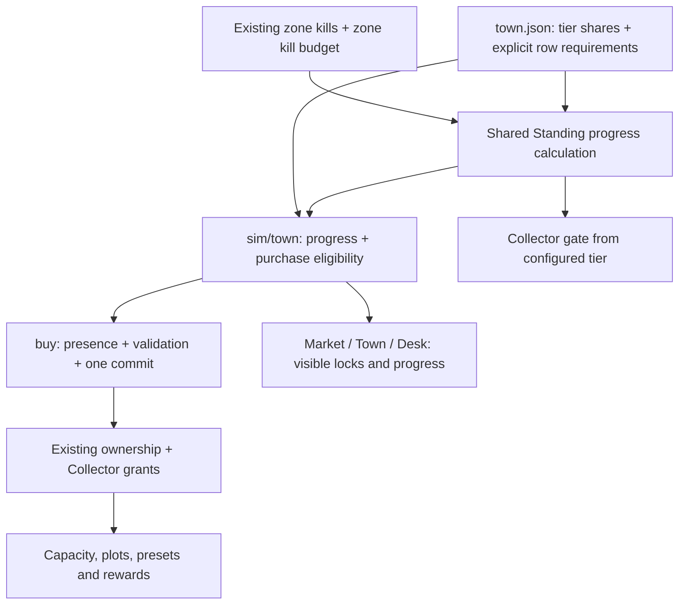

# Standing unlocks — implementation record

Requested scope: implement Standing purchase gates, the advertised preset purchase, accurate progress readouts, validation and player documentation. This document records the implemented behavior.

**Status: IMPLEMENTED.** The owner adopted the tier mapping by requesting implementation of this plan. The gates apply to future purchases; existing ownership and save data keep their effects.

## 1. Implemented behavior

Keep existing Standing thresholds in `tools/data/town.json`: I = 0.30, II = 0.75, III = 1.40 of the settlement's zone kill budget. Keep the current kill-based accrual, prices, Haggling discounts, RNG and offline rules.

| Tier | Role |
|---|---|
| 0 | Basic organization, repair, information and travel services |
| I | Optional storage/capacity expansions, houses and additional farm plots |
| II | Existing Collector set turn-in access |
| III | Shop appearance purchases and extra saved filter presets |

This replaces the ambiguous phrase “that stall's second stock line” with explicit service requirements. Do not derive requirements from array position or `kind`. A filter preset is a convenience feature, not a visual cosmetic.

### Explicit catalogue mapping — implemented

Add `required_standing_tier` to every row in `one_time` and `repeatable`:

| Requirement | Row IDs |
|---|---|
| 0 | `bag_slot`, `potion_carrier_slot`, `skip_token`, `repair`, `repair_ironrow`, `collector_hint`, `waypoint_warp` |
| I | `stash_tab_1`, `stash_tab_2`, `stash_tab_3`, `stash_tab_4`, `stash_tab_5`, `stash_tab_6`, `herb_pouch_ii`, `herb_pouch_iii`, `plot_deed_4`, `plot_deed_5`, `house_ashfall`, `house_highspire`, `house_vermolch` |
| III | `filter_preset`, `pedlar_rotation`, `prestige_title`, `banner_coldres`, `tint_heavy` |

Add `standing.collector_required_tier: 2` and consume it in the existing Collector gate. Collector set IDs inside settlement stock metadata are not ordinary shop rows; preserve their existing routing.

Requirements apply to the **selling town's** Standing. Existing settlement stock arrays remain the catalogue: do not add unstocked rows or automatically expose the rest of a price ladder. A town need not offer something at every tier.

Keep locked rows visible with their price, required tier and a visible refusal reason. The player should see what progress unlocks. Browsing is read-only; a purchase still requires presence at the seller and writer access.

## 2. Compatibility and scope boundaries

- Enforce new requirements on future purchases only. Existing `town.owned`, gear, gold, plots, storage, presets, Collector completion and cosmetic rewards retain their meaning and effects even below a new requirement.
- Preserve already-earned Collector banners/titles/preset slots. Tier III shop requirements must not restrict receiving or using a Tier II Collector reward.
- Derive Standing and ownership effects from existing state. Add no saved unlock flags, migration rewards, reset, refund or schema bump. Verify current-schema and older supported save loading.
- Retain quantity limits, daily caps, Haggling price calculation and all existing validation. A refusal changes no gold, ownership, pedlar count, task counter or inventory.
- Preserve the existing writer boundary: `App.svelte:doBuy` checks `transactionWriter`; `canBuy` previews eligibility and `buy` checks settlement presence plus eligibility. Verify read-only behavior through that UI boundary.
- Keep basic repair and manual Waypoints available at Tier 0. Do not couple ordinary-stall gates to Black Market, trading, Delivery or Haggling progression.
- Cosmetic scope is access to the existing appearance rows and their existing ownership records. A new cosmetic catalogue, random appearance identity, equipping/tint renderer or character customization screen is outside this plan. Do not invent what a generic pedlar purchase visually awards.
- Do not introduce task/Boss Standing bonuses. `standing.earnt_from` now states that only kills in the settlement's zone count; task claims currently pay stones. Any future task/Boss Standing bonus is a separate policy decision.
- Preserve existing purchase caps while fixing preset fulfillment. The preset row says `charge: one_per_band`, but purchases currently store only row IDs and have a global quantity cap. Per-band purchase enforcement/provenance is separate work; do not invent migration history or add it implicitly here.
- Follow `AGENTS.md`: active local sandbox only; no Git inspection, commit comparison, other worktrees, commit, push or pull.

## 3. Verified implementation map

Paths/symbols below were inspected in the current local workspace. Recheck affected sections before editing; line numbers are intentionally omitted.

| Existing owner | Implemented role |
|---|---|
| `tools/data/town.json` | Tier shares, explicit requirement on every ordinary shop row, Collector requirement, preset grant, stock IDs and prices |
| `game/src/sim/town.ts` | `standingProgress` reads zone kills and budget, `canBuy` gates by seller-town requirement, `buy` revalidates and writes `town.owned` |
| `game/src/sim/collector.ts` | `setUnlocked` reads the configured Collector tier; `turnIn` checks it before consuming gear; rewards update `grants` |
| `game/src/sim/filter.ts` | `presetSlots` counts the base slot, existing Collector grants and owned `filter_preset` rows |
| `game/src/sim/slots.ts`, `farm.ts`, `town.ts` | Purchased capacity, plots, houses and stash tabs already derive from ownership; keep those readers independent of current Standing |
| `game/src/ui/Market.svelte` | Shows the price and a visible `canBuy` refusal beside locked rows |
| `game/src/ui/TownHub.svelte` | Shows the inspected town's actual tier, kills and next integer threshold, including remotely |
| `game/src/App.svelte` | `doBuy` checks `transactionWriter`; legacy stall shows visible refusals; Desk shares the same progress calculation |
| `game/src/state/save.ts` | `migrate`, `importJson`, `exportJson`; current schema 17; preserve existing ownership and grants |
| `engine/types.ts` | `TownData` is a deliberately partial Collector view, not the full town schema; extend only necessary typed seams |
| `tools/trade.ts` | TC11 validates tiers, row/Collector requirements, preset grant and stock references |
| `game/src/wiki/pages.ts` | Player-facing Standing and stall claims use the implemented thresholds; `docs/wiki/` was regenerated |

## 4. Integration



### Implementation sequence

1. **Data and pure calculation.** Add the explicit requirements and Collector tier. `game/src/sim/town.ts:standingProgress` uses the existing shares and budget; `standingShare` and `standingTier` delegate to it. It returns the current tier and next integer kill threshold (`ceil(share × budget)`), reports no next tier after the last, and leaves invalid/nonpositive budgets at Tier 0.
2. **Purchase gate.** Add one shared requirement check in `canBuy`; `buy` must revalidate it. Preserve sold-out/owned information and existing quantity/daily/price checks. Check the selected seller's zone, not the current hunt zone. Invalid row requirements must not silently become unlocked. Do not turn a refusal into a payment or ownership write.
3. **Collector.** Replace the magic tier number in `setUnlocked` with `standing.collector_required_tier`. Preserve held gear collection before unlock, atomic turn-in, locked-piece protection and one-time rewards.
4. **Readouts.** Market and legacy stall render the shared refusal visibly, with accessible labels. TownHub and Desk display Standing for the town being inspected even when remote; local presence affects actions only. Use the shared next-threshold readout instead of calling the full budget “Tier I's requirement.” Keep layout inside existing regions.
5. **Validation and player documentation.** Validate strictly increasing finite shares, valid integer row/Collector requirements within the configured tier range, and valid referenced IDs. Do not impose content-count or pacing gates. Update only affected glossary/game-rule/wiki sections and rebuild wiki.

## 5. Completed execution packets

### A. Make purchased filter presets usable

**Status: IMPLEMENTED.** This fixes the advertised purchase and composes with Collector grants.

- **Objective:** each purchased `filter_preset` adds the advertised saved slot, alongside Collector rewards.
- **Verified context:** `town.ts:buy` records purchases; `filter.ts:presetSlots` currently ignores them. `savePreset` uses `presetSlots` to refuse unearned slots.
- **Scope:** add `filter_preset_grant: 1` to the row in `town.json`; derive purchased slots from ownership and that metadata. Reuse the catalogue reader without introducing a module cycle. Keep `grants.filter_presets` as existing Collector grants.
- **Sequence:** add a failing purchase-to-`savePreset` test in the existing filter/town owner tests; implement the derived capacity; verify existing Collector grants plus purchases compose once.
- **Acceptance:** legacy owned purchases work after load; buying one adds one advertised slot; an unaffordable/refused purchase adds none; reload/import does not award again; saved rule tables remain intact. Do not increment saved `grants` on purchase or migration, which would risk replay/double credit.
- **Stop:** investigate if current migration already incorporates shop purchases into `grants`, or if a purchase has a different authored grant than this inspected row.

### B. Correct Standing progress information

**Status: IMPLEMENTED.** The UI describes existing thresholds without changing them.

- **Objective:** display current town tier, earned kills and the next tier's required kills accurately.
- **Scope:** existing Standing calculation and shared read model used by purchase gating, TownHub and Desk.
- **Sequence:** test one kill below, at and above the integer threshold for each configured tier; centralize calculation; replace misleading prose and remote-zero readouts; inspect actual UI.
- **Acceptance:** threshold equality unlocks the tier; a remote town shows its own existing progress; maximum tier has no fictitious next target; formatting does not affect comparisons; no saved state, prices or RNG change.
- **Stop:** report if the actual source of Standing has changed from the inspected kill-based model.

## 6. Acceptance checklist for the adopted unlock policy

| Scenario | Observable proof |
|---|---|
| Tier 0 / I / III purchase | Basic service allowed; expansion/appearance row refused below its configured requirement and allowed at it |
| Exact threshold | `ceil(share × budget) - 1`, threshold, threshold + 1 produce the correct tier and purchase result |
| Town isolation | High Standing in town A cannot buy a gated row in town B; remote preview uses B |
| Atomic refusal | Insufficient Standing, wrong location, read-only, insufficient gold, cap or stock refusal leaves all relevant state unchanged |
| Collector | Below II refuses; at II succeeds once; existing completed sets and rewards survive load; Collector appearance rewards work before III |
| Existing ownership | An old low-Standing save keeps purchased stash/plot/capacity effects and all preset rule tables |
| Presets | Shop grant + Collector grant compose exactly once; repeated save/load/import changes neither entitlement nor rules |
| Independence | Haggling discount remains in the final price; Black Market, quote/sale, Delivery rewards and RNG order remain unchanged |
| Catalogue integrity | Reordering stock changes display order only; requirements are data, not position or kind inference |
| UI | Locked row visible with price/reason; keyboard can reach explanatory text; no unintended overflow at 1920 × 1080 |

Use existing owners: `game/tests/simModules.test.ts`, `filter.test.ts`, `trade.test.ts`, `audit-regressions.test.ts`, `save-fidelity.test.ts`, `destination.test.ts`, `black-market.test.ts`. Do not mechanically set all fixtures to maximum Standing; keep meaningful Tier 0 and refusal coverage.

Commands for the implementing agent:

```powershell
# From game/: focused tests first
npm run test -- tests/simModules.test.ts tests/filter.test.ts tests/trade.test.ts tests/audit-regressions.test.ts tests/save-fidelity.test.ts tests/destination.test.ts tests/black-market.test.ts

# From repository root
npm run check
npm run verify
npm test
npm run wiki
```

Run focused red/green checks first; the shared town/preset change warrants the broader suite once at completion. `check` already includes typecheck and Svelte. Inspect the affected live components in the integrated browser at `http://localhost:5173/__showcase` at 1920 × 1080; reuse the existing port-5173 server. Inspect edited files directly, not against Git. Do not claim an unrun check passed.

## 7. Completion review

PASS = implemented and verified against the local source and affected contracts.

| Task | G1 scope | G2 source | G3 decisions | G4 contracts | G5 safety | G6 proof | G7 sequence | G8 isolation | Verdict |
|---|---|---|---|---|---|---|---|---|---|
| Standing shop gates | PASS | PASS | PASS | PASS | PASS | PASS | PASS | PASS | COMPLETE |
| Purchased preset entitlement | PASS | PASS | PASS | PASS | PASS | PASS | PASS | PASS | COMPLETE |
| Accurate progress readout | PASS | PASS | PASS | PASS | PASS | PASS | PASS | PASS | COMPLETE |

Task/Boss Standing bonuses and cosmetic rendering/equipping remain separate product work. The existing task/Boss bonus wording was removed from the data description; no progression bonus was added. Per-band purchase provenance for the `one_per_band` preset charge remains outside this implementation.

Verification: `npm run check` passed with 0 TypeScript/Svelte errors and warnings; `npm run verify` passed all 9 cages (trade 11/11); `npm test` passed 48 files / 625 tests. `npm run wiki` rebuilt the 19 player wiki pages. Market, TownHub and Desk were inspected in the integrated browser at 1920 × 1080; lock reasons and prices were visible, including for remote Highspire, and the affected panels fit their width.

## 8. Next-agent prompt

> For follow-up work, read `AGENTS.md` and `draft/standing-unlocks-plan.md` in the active local sandbox. Standing purchase gates, preset fulfillment and progress readouts are implemented. Preserve existing ownership and saves, use no Git inspection or other worktrees, and do not add task/Boss accrual or cosmetic rendering without an owner decision. Report only new gaps or changes.
